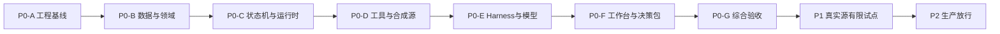

# 财务共享智能运维 Agent 开发任务总览

> 状态：待复核的开发任务基线；本任务包不代表代码已实现。
> 目标代码仓库：`D:\Work\CR_git\emsld\finance_agent`
> 方案依据：[生产落地技术方案](../生产落地技术方案/00-财务共享智能运维Agent-生产落地技术方案.md)
> 使用方式：先复核本任务包，再按依赖顺序开发。P0 任务可以直接实施；P1/P2 在入口事实具备后细化。

## 1. 文档索引

| 文档 | 任务范围 |
|---|---|
| [01-P0工程与技术验证](01-P0工程与技术验证.md) | 空仓库初始化、依赖兼容、配置、JAR/Docker、最小诊断 |
| [02-P0领域模型与数据库](02-P0领域模型与数据库.md) | Flyway、schema、领域对象、存储、摘要和事务 |
| [03-P0任务状态机与运行时](03-P0任务状态机与运行时.md) | 状态机、审批、Worker、租约、幂等、恢复 |
| [04-P0工具网关与合成适配器](04-P0工具网关与合成适配器.md) | 工具目录、字段边界、合成源、覆盖度、规则计算 |
| [05-P0-Harness与模型](05-P0-Harness与模型.md) | Harness 核心、PostgreSQL 状态、DeepSeek、扩展能力 |
| [06-P0工作台与决策包](06-P0工作台与决策包.md) | Vue 工作台、SSE、草稿、复核、发布和查看 |
| [07-P0测试与验收](07-P0测试与验收.md) | 合成纵向切片、负向门禁、P0 证据包 |
| [08-P1真实源试点](08-P1真实源试点.md) | 统一认证、真实只读源、有限试点和量测 |
| [09-P2生产放行](09-P2生产放行.md) | 生产版本、迁移、签署、移交和放行 |
| [10-依赖阻断与决策记录](10-依赖阻断与决策记录.md) | 外部事实、阻断动作、固定决策和例外 |
| [11-简要测试方案](11-简要测试方案.md) | 测试范围、命令、双方责任和证据 |

## 2. 已确认开发基线

| 维度 | 决定 |
|---|---|
| 仓库结构 | `backend/`、`frontend/`、`contracts/`、`deploy/`、`docs/`、`scripts/`；保留现有 `solutions/` |
| Java | `cn.com.crc.ems:finance-agent`，根包 `cn.com.crc.ems.finance.agent`，应用名 `finance-agent` |
| 后端 | JDK 17、AgentScope Java 2.0.3、Spring Boot 4.0.4；单 Maven 可执行 JAR、按能力分包 |
| 数据访问 | Spring JDBC/显式 SQL 为首选；核心事务和锁不依赖隐式 ORM 行为 |
| 前端 | Vue 2.7.16、TypeScript、Vite、Element UI 2.x、Vue Router 3；版本在兼容性任务中锁定并记录 EOL 例外 |
| 数据库 | 已有 `postgres-pgvector`；PostgreSQL 17.11、pgvector 0.8.6；数据库名 `finance_agent` |
| 部署 | 本地 JAR或单应用 Docker 镜像；不使用 Compose；数据库独立运行 |
| API/运行 | Spring MVC 快速返回，PostgreSQL Worker 异步执行，SSE 推送公开业务事件 |
| 模型 | Stub 优先；DeepSeek `https://api.deepseek.com`、`deepseek-flash`、OpenAI Chat Completions |
| Thinking | 默认 high；`reasoning_content` 仅在当前循环易失内存中传递，不记录、不展示 |
| 身份 | P0 使用仅限 `local/test` 的合成身份；`prod` 检测到测试身份时启动失败 |
| Sandbox | JAR 模式验证本机 Docker；应用容器不挂载 Docker socket |
| 后移能力 | 统一认证、真实财务源、RAG/Embedding、正式对象存储、CI、PDF |

## 3. 阶段依赖

允许在依赖稳定后并行开发前端静态页面和后端模块，但集成验收必须按上述顺序收敛。

## 4. 任务状态与完成定义

### 4.1 状态

| 状态 | 含义 |
|---|---|
| `TODO` | 前置条件未全部满足或尚未开始 |
| `IN_PROGRESS` | 正在实现；同一开发者同时只保持少量活动任务 |
| `BLOCKED` | 明确依赖外部事实、缺陷或人工验证，并记录阻断编号 |
| `DONE` | 产物、检查、负向验证和证据均满足完成定义 |

本次任务基线所有任务初始状态均为 `TODO`。

### 4.2 通用完成定义

一个 P0 开发任务只有同时满足以下条件才能视为完成：

1. 任务列出的代码、迁移、契约或文档产物已提交；
2. 代码不越过模块、数据和安全边界；
3. “实现方检查”命令通过；
4. 任务要求的负向检查已覆盖，或明确交给用户手动验证；
5. 完成证据至少包含提交号和检查结果；需要人工验证时附用户结果；
6. 新发现的未知事实已登记到依赖阻断表，不以临时默认掩盖。

## 5. P0 里程碑

| 里程碑 | 结果 | 出口门禁 |
|---|---|---|
| `M0` 工程可编译 | 后端、前端、契约和镜像骨架 | JAR/前端构建通过；版本清单确定 |
| `M1` 数据可迁移 | 自有 PostgreSQL schema 和仓储 | Flyway 可重复执行；核心事务检查通过 |
| `M2` 任务可恢复 | 状态机、Worker、审批、租约、幂等 | 中断点行为可证明；等待任务不占 Worker |
| `M3` 合成调查可执行 | 工具网关、字段裁剪、合成源、覆盖度、规则 | 禁止字段和写源负向门禁通过 |
| `M4` Harness 核心跑通 | HarnessAgent、Session、Plan、HITL、PG 状态、模型 | Stub 自动契约通过；DeepSeek 由用户手动验证 |
| `M5` 业务闭环可操作 | Vue 工作台、SSE、草稿、复核、发布、查看 | 准确草稿、范围重查和原子发布通过 |
| `M6` P0 通过 | 合成纵向切片与完整 Harness 能力证据 | 三项零容忍门禁满足；用户完成手动验收 |

## 6. 首个核心纵向切片

首个可运行版本使用“合成人员 `EMP-SYN-001` 已离职”作为运维提供的任务前提，贯通：

`发起 → 范围确认 → Harness 推荐步骤 → 人工审批 → 合成源查询 → 最小证据 → 确定性计算 → 专业确认 → 草稿 → 复核 → 发布前重查 → 不可变发布 → 查看 → 交接`

合成源必须包含当前引用、未来引用、未确定项、分页失败、跨源冲突、允许读但禁止留存字段、禁止读取字段和发布前新增引用。

## 7. 开发责任边界

| 工作 | 实现方 | 用户 |
|---|---|---|
| 代码、Flyway、配置样例、构建脚本 | 负责 | 复核 |
| 后端/前端编译和静态检查 | 负责 | 可复验 |
| 指定 OpenAPI/JSON Schema 契约检查 | 负责 | 可复验 |
| 长期运行 JAR/应用容器 | 不执行 | 负责 |
| 真实 DeepSeek 调用 | 不执行 | 手动发起并记录结果 |
| 其余集成、故障注入、性能和人工页面测试 | 提供方案和支持修复 | 负责执行 |
| 真实统一认证、真实财务源和生产发布 | 后续按任务实现 | 提供环境、契约和验收 |

## 8. P0 硬门禁

- 禁止读取字段持久化或发送模型：`0`；
- 财务源写入：`0`；
- 未经准确草稿复核的发布：`0`；
- RAG、历史记忆或模型推断被标为当前配置事实：`0`；
- 覆盖不完整时产生全范围否定结论：`0`。

## 9. 版本和变更原则

任务基线不设置人天、负责人和生产日期。任何涉及真实字段、权限、容量、保留期和模型限额的结论必须引用证据。任务实施中如发现 AgentScope 2.0.3 API 与设计不符，先完成兼容性 spike 并更新实现决定，不能静默替换业务控制边界。

