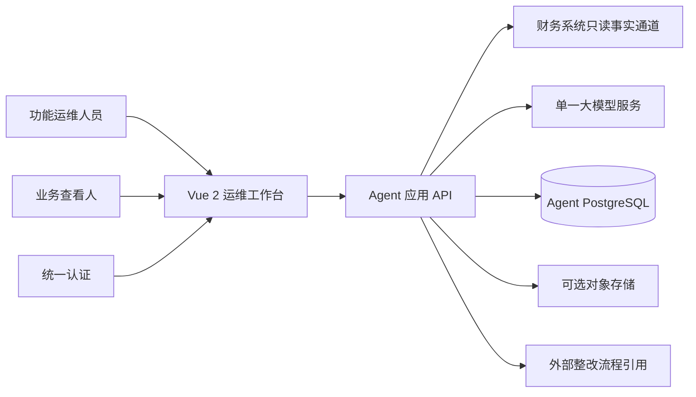
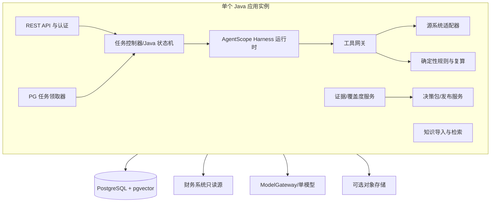
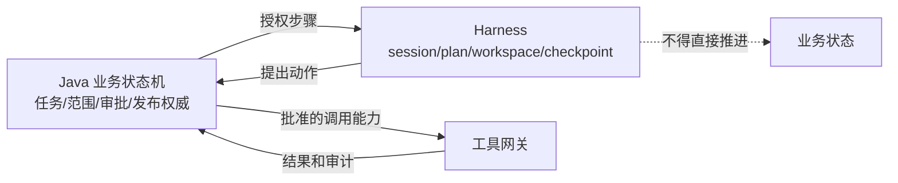
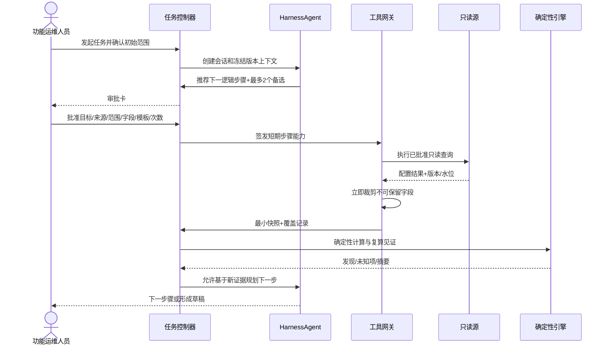
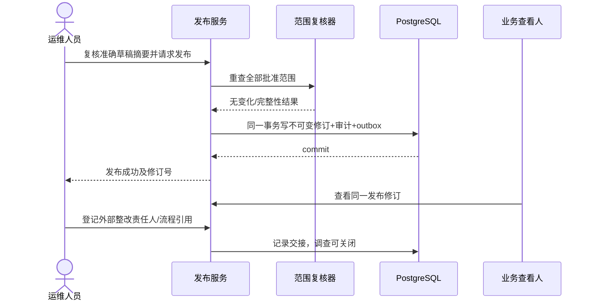
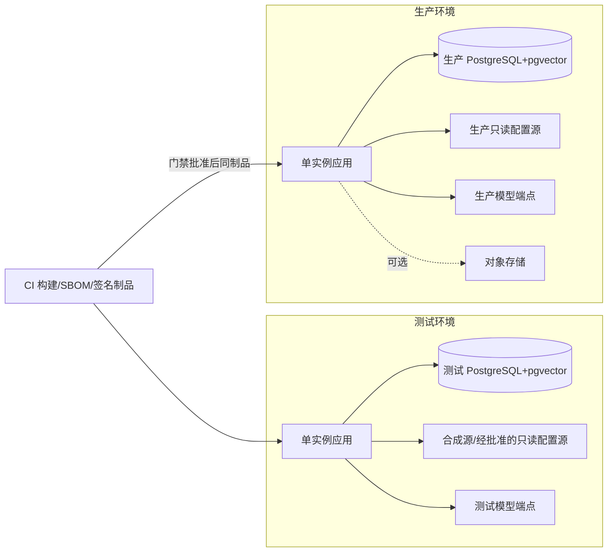

# 财务共享智能运维 Agent 生产落地技术方案

> 状态：生产实施设计基线；须完成本文 P0/P1/P2 门禁后方可生产放行，不表示系统已上线。
> 适用范围：首期接入一套财务共享系统，服务功能运维人员，以人工发起的有界任务开展只读调查与分析。
> 决策依据：2026-09-21 前完成的需求澄清结论优先；现行详细方案 `../财务共享智能运维Agent-详细方案.md` 提供业务设计基线；AgentScope Java 2.0.3 官方发布物提供框架版本依据。
> 配套附件：[附件 A：领域模型、数据库与状态机](附件A-领域模型数据库与状态机.md) · [附件 B：接口、工具与适配器契约](附件B-接口工具与适配器契约.md) · [附件 C：Harness 能力映射与验证](附件C-Harness能力映射与验证.md) · [附件 D：测试、验收与 P0 清单](附件D-测试验收与P0清单.md)

## 1. 结论摘要

本方案可以作为生产研发和联调的技术基线，但不能跳过 P0 事实盘点后直接承诺生产可用。方案把生产能力拆成三类：

1. **已确定设计**：业务边界、只读原则、逐步确认、状态权威、证据规则、技术栈、单实例部署、发布事务和 Harness 治理。
2. **待实现能力**：任务控制器、只读适配器、证据与规则引擎、Agent 运行时、工作台、发布和审计。
3. **待 P0 证实事实**：源对象字段及查询完整性、模型协议、统一认证细节、数据库服务端版本、对象存储、并发预算和保留策略。每项均有阻断动作，不能以默认值替代。

系统首期只确认**配置事实**和基于配置的**条件性风险**，不读取真实发生的金额业务数据，不判断实际业务影响，不写财务系统。输出是一份经功能运维人员复核、可保存、可复算、可交接的调查决策包，包含事实、未知项、建议方案和验证准备。

## 2. 范围与责任

### 2.1 首期能力边界

| 维度 | 生产基线 |
|---|---|
| 使用者 | 功能运维人员发起、逐步确认、专业复核、发布；业务用户只读查看同一份已发布决策包 |
| 任务形态 | 人工发起，有明确目标、对象、范围、来源和停止条件；Agent 不主动巡检或自行扩大范围 |
| 数据 | 获准配置数据及必要人员/组织/岗位/角色关联；真实金额、单据、支付等已发生业务数据禁止读取 |
| 动作 | 只读调查、确定性计算、解释、建议方案、验证准备；不写源系统，不执行整改 |
| 结论 | 配置事实、当前/未来/未确定状态、条件性配置风险；实际影响保持未知 |
| 决策 | 可计算判断由确定性程序完成；专业事实和影响解释由功能运维人员逐项确认 |
| 交接 | 发布决策包后可关闭调查；外部整改只记录流程引用、责任人和状态 |

“审批人员 A 离职”仅作为首个验证场景。A 的离职状态和唯一人员编号由运维人员作为任务前提提供并记录来源；Agent 调查 A 在已批准范围中的当前及未来配置引用，不声称已覆盖所有业务场景。

### 2.2 角色

| 角色 | 权限和责任 |
|---|---|
| `OPERATOR` | 发起任务、确认范围和步骤、确认专业判断、复核准确草稿、发布、交接 |
| `VIEWER` | 查看已发布且获授权的同一份决策包 |
| `PLATFORM_ADMIN` | 维护用户角色、运行配置、工具/技能发布和 break-glass 账号；不自动获得源数据范围 |
| 源系统/数据负责人 | 确认来源、字段白名单、权威级别、版本和完整性语义 |
| 技术实施人 | 实现、迁移、测试、版本与供应链签署 |

首期一个管理员可同时承担发起、复核和发布，但三个动作必须是独立记录。系统预留双人复核策略，不在首期强制。

### 2.3 本次不展开的内容

监控告警和灾备高可用的详细设计不属于本技术方案；生产组织如要求，应另立专项设计和验收。

## 3. 设计原则

1. **业务状态优先**：Java 状态机是任务和发布的唯一权威；模型、Harness、前端不能直接改状态。
2. **先边界后调查**：每个步骤先确认目标、来源、范围、字段、模板版本和调用上限，再执行工具。
3. **最小数据闭环**：读取、保留、发送模型是三套独立权限；只保存与结论直接相关的获准字段。
4. **事实与解释分离**：源快照、确定性计算、模型解释、人工专业确认分别标识和引用。
5. **覆盖决定措辞**：完整性不足时可以发布部分结果，但不能发布全范围否定结论。
6. **时点与版本并存**：所有证据记录核查时间和对应版本或结果摘要；当前、未来、未确定分别输出。
7. **发布不可变**：复核的是准确修订，发布后不覆盖；变化形成新修订并保留前后链。
8. **未知必须阻断具体动作**：未盘点事实不会阻断全部研发，但会阻断依赖该事实的联调、结论或放行。

## 4. 总体架构

### 4.1 系统上下文

财务系统只向 Agent 暴露批准的查询接口或只读数据库视图。Agent 不持有写凭证。统一认证提供人员身份，Agent 自有库维护 `OPERATOR`、`VIEWER`、`PLATFORM_ADMIN` 角色；独立登录仅供受控 break-glass 管理入口。

### 4.2 模块与容器

采用模块化单体。API 与 Worker 在同一进程、不同线程池中运行；等待人工确认的任务不占 Worker。任务、租约、checkpoint 和 outbox 使用 PostgreSQL，不引入消息中间件。首期生产单实例，进程由部署平台自动拉起。

### 4.3 模块责任

| 模块 | 责任 | 明确禁止 |
|---|---|---|
| 任务控制器 | 创建任务、冻结范围、验证步骤审批、推进状态、租约和恢复 | 接受模型直接改状态 |
| Harness 运行时 | 计划、会话、上下文压缩、工具编排、中断恢复 | 越过任务控制器调用源或发布 |
| 工具网关 | 白名单、参数、字段、预算、幂等、审计前置/后置校验 | 动态执行未注册工具 |
| 源适配器 | 调用 API/只读视图、字段裁剪、分页和覆盖度记录 | 使用写凭证、缓存未获准字段 |
| 确定性引擎 | 关系计算、规则判断、摘要、复算见证 | 生成无版本的隐式业务规则 |
| 证据服务 | 最小字段快照、来源、时点、版本、覆盖、冲突 | 把 RAG 文档标为当前事实 |
| 发布服务 | 准确草稿复核、范围重查、不可变修订、审计原子提交 | 覆盖已发布修订 |
| 知识服务 | 获准文档解析、分块、向量化、发布、检索 | 抓取任意网页/邮箱或确认当前配置 |

## 5. 权威状态与调查循环

### 5.1 业务状态和 Harness 状态

业务对象保存在 `task_*`、`evidence_*`、`packet_*`、`audit_*` schema；Harness 状态保存在 `harness_*` schema。二者通过 `task_id`、`user_id`、`session_id` 关联。恢复时先加载业务状态，再验证 Harness checkpoint 与当前批准步骤一致；不一致则停在 `WAITING_STEP_APPROVAL`。

### 5.2 受约束动态调查循环

每次只有一个当前逻辑调查步骤和一个有效租约。相同参数的有限重试可以复用批准；来源、范围、字段、模板版本或调用上限改变时必须重新批准。上下文压缩只能摘要已持久化引用，不能把摘要当作新证据。

### 5.3 状态骨架

`DRAFT → WAITING_SCOPE_CONFIRMATION → READY → WAITING_STEP_APPROVAL → RUNNING_STEP → ANALYZING → WAITING_PROFESSIONAL_CONFIRMATION → DRAFT_PACKET → WAITING_REVIEW → RECHECKING_SCOPE → READY_TO_PUBLISH → PUBLISHED → HANDED_OFF → CLOSED`

异常分支包括 `PAUSED_MODEL_UNAVAILABLE`、`PAUSED_BUDGET`、`PAUSED_SOURCE_UNAVAILABLE`、`STALE_APPROVAL`、`FAILED_RECOVERABLE` 和 `CANCELLED`。完整转移和守卫见附件 A。

## 6. 事实、证据与一致性

### 6.1 事实通道

源接入优先级为：

1. 已有只读查询 API，能提供投影、分页、版本和错误语义时优先。
2. 经数据负责人批准的只读数据库视图，使用独立只读账号和 SQL 模板。
3. 若两者均存在，逐对象登记权威来源；冲突不能用模型裁决，标为 `UNKNOWN_SOURCE_CONFLICT`。

`SourceCatalog` 必须登记对象、字段、读/留存/模型权限、权威级别、查询模板、分页、版本/水位和脱敏规则。真实来源未完成登记前只能运行合成适配器。

### 6.2 最小字段快照

如果源返回 A 表 50 个字段而任务只允许保留 3 个：

- 50 个字段都获准读取时，可信适配器在易失内存中保留 3 个，其余在日志、缓存、checkpoint、模型调用前删除。
- 任一返回字段禁止读取时，整个通道失败关闭，必须由源端投影或更窄接口解决。

快照只包含批准字段、对象标识、`checked_at`、有效时间、源版本/水位或规范化结果摘要。原始提示词和模型响应不长期保存；保存模型/提示模板版本、证据 ID、字段清单、内容哈希、token 和结构校验元数据。

### 6.3 当前、未来和未确定

每条配置关系按核查时点分类：

- `CURRENT_EFFECTIVE`：当前满足确定性生效条件。
- `FUTURE_SCHEDULED`：源事实明确未来生效条件或时间。
- `UNDETERMINED`：缺少时间、规则或来源冲突，不能机械判定。

时间推进即使没有源版本变化，也可能使未来配置转为当前配置。因此发布前复核必须使用新的 `checked_at` 重新分类，不能只比较源版本。

### 6.4 覆盖度与发布前复核

`CoverageRecord` 记录范围全集确定方式、查询条件、模板版本、页码/总量、关系路径、失败项、源水位及结果摘要。无一致水位且分页期间发生变化时，重试枚举或标记覆盖不完整。

发布前对整个批准范围重新枚举，比较：

- 新增对象/引用；
- 删除对象/引用；
- 获准字段变化；
- 当前/未来分类变化；
- 查询模板、规则、来源权威或范围版本变化。

任一变化影响草稿时，准确草稿复核失效，生成新修订再复核。覆盖不完整仍可发布明确标记的部分成果，但不得写“全范围无引用”等否定结论。

## 7. 决策包与发布

### 7.1 决策包结构

1. 任务问题、前提及来源；
2. 已批准范围和排除范围；
3. 数据来源、核查时间、版本和覆盖状态；
4. 当前生效配置事实；
5. 未来计划生效配置事实；
6. 未确定、冲突和缺口；
7. 确定性计算结果及复算状态；
8. 经运维确认的专业判断；
9. 建议方案、适用前提、风险和“待业务确认”项；
10. 验证准备、所需输入、预期结果和执行主体；
11. 外部整改流程引用和状态；
12. 修订、复核、发布和前版引用。

首期以结构化数据库记录为规范结果，Vue 工作台展示同一份内容，并生成 HTML 快照；PDF 作为 P2 后续能力。

### 7.2 发布与交接

发布修订没有固定失效年限，但始终显示核查时点和源版本。后续配置变化不会覆盖旧修订，而是创建新任务或新修订。若未来强制接入独立审计系统，再启用 outbox 确认门禁；首期本地审计与修订同事务即可。

## 8. AgentScope Harness 落地

### 8.1 版本基线

采用 AgentScope Java 2.0.3 BOM。官方 2.0.3 根 POM 使用 Java 17，CI 在 Temurin 17 上验证；BOM 对齐 Spring Boot 4.0.4、Spring Framework 7.0.7、PostgreSQL JDBC 42.7.11 和 pgvector Java SDK 0.1.6。实施构建必须使用 BOM，不单独漂移框架依赖。

### 8.2 使用方式

生产主 Agent 使用 `HarnessAgent`，不以裸 `ReActAgent` 作为最终运行时。启用：

- session 与 state persistence；
- workspace 和计划；
- context compression；
- permission/HITL；
- interruption/resume；
- sandbox、skills、subagents、长期记忆的受控集成面。

Harness 权限控制是第一层，业务工具网关和 Java 状态机是第二层。即便 Harness 判定允许，工具网关仍验证步骤能力、字段、模板、预算、幂等和当前状态。

### 8.3 生产约束

| 能力 | 生产策略 |
|---|---|
| 工具 | 编译期注册和显式白名单；禁止运行时 MCP 或动态工具发现 |
| Sandbox | 仅合成/非敏感辅助计算；无源凭证、无生产网络、无决策包发布能力 |
| Skills | 仅管理员审核和版本发布的技能；候选自演进只在测试环境 |
| Subagents | 仅登记的专用子 Agent；不继承额外数据范围，不得发布或扩大任务 |
| 长期记忆 | 只存获准、非敏感的经验摘要；不自动记忆配置值、人员事实和决策结论 |
| 计划 | 展示给运维人员；计划不能替代逐步确认 |

完整验证矩阵见附件 C。

## 9. RAG 与知识管理

PostgreSQL 首期安装 pgvector，语料库允许为空。RAG 只用于制度、手册和说明材料，不用于确认当前源配置。

导入链路为：上传 → 恶意内容/格式检查 → 解析 → 元数据审批 → 按文档类型确定性分块 → 向量化 → 抽样问答 → 发布。首期格式为 PDF、DOCX、Markdown 和纯文本；OCR 结果必须人工抽样。任意网页、邮箱和压缩包不直接导入。

分块元数据至少包含来源、标题、章节、页码、文档版本、适用范围、发布时间和发布状态。小语料先使用精确扫描；只有规模和延迟量测证明需要时才建 HNSW。Embedding 模型独立版本化并记录维度，升级时建立新向量集、重建索引、验证后切换。

## 10. 安全和权限

### 10.1 身份与密钥

- 统一认证映射唯一人员编号；Agent 自有库维护角色。
- 保留独立 break-glass 登录，只允许平台管理员，使用受控流程并完整审计。
- 密钥通过受控环境变量注入；不进入源码、数据库配置表、日志或前端。
- 测试和生产使用不同凭证、数据库角色、模型端点配置和数据源。

### 10.2 数据库角色

按 schema 分离 `migration`、应用读写、发布、知识导入、只读查看和审计角色。应用账号不能执行 DDL；Flyway 使用独立迁移角色。应用字段不做额外加密；传输、磁盘和备份由平台既有安全能力保障。

### 10.3 关键负向控制

- 源系统凭证必须只读，集成测试验证写语句和写接口均失败。
- 禁止字段注入时，字段不得出现在日志、trace、证据、prompt、checkpoint 或导出包。
- 未批准步骤、过期审批、租约不符、模板版本漂移均失败关闭。
- 模型输出不符合 JSON Schema 时不能落为业务对象。
- 未复核准确草稿、范围复核发生变化或审计事务失败时不能发布。

## 11. 应用与数据技术栈

| 层 | 选型 | 约束 |
|---|---|---|
| 后端 | JDK 17、Spring Boot 4.0.4、AgentScope Java 2.0.3 BOM | 以官方 BOM 锁定组合；P0 编译和依赖扫描 |
| 前端 | Vue 2.7.16 | 优先复用现有 Vue 2 工具链；记录 EOL 风险和例外 |
| 数据库 | PostgreSQL + pgvector | 服务端版本 P0 确认；schema/角色分离；Flyway |
| 模型 | 单一模型，经 `ModelGateway` | 无自动切换；结构化 JSON Schema；不可用时暂停模型步骤 |
| 对象 | 可选对象存储 | 仅保存批准的大文档/导出；不可用时不保留大原件 |
| 打包 | 容器镜像 + 可执行 JAR | 测试/生产同一制品；单实例，不假设 Kubernetes |

规则核心算法用版本化 Java 代码实现；对象映射和简单阈值使用受控配置。首期不提供任意表达式编辑器。每个任务冻结应用、规则、提示模板、工具目录、源映射、模型和知识库版本组合。

## 12. 部署设计

### 12.1 测试与生产

测试环境优先使用合成数据；为验证真实兼容性，可以经批准读取受控配置字段。生产应用和 Worker 同进程，使用独立连接池/线程池配额。维护时先停止领取新任务，等待运行步骤到安全检查点，再关闭进程；重启后由租约扫描器恢复。

### 12.2 数据库迁移和发布

1. CI 固定依赖、生成 SBOM、运行编译、单元/契约/集成/负向测试。
2. 独立 Flyway 角色在测试应用迁移，验证向前兼容和回滚预案。
3. 同一已签名制品进入生产；生产不直接修改代码、规则、提示或 schema。
4. 提示、规则、工具、技能、源映射改变均形成版本，经过测试和审计；当前可由单管理员自审发布。
5. 依赖漏洞不得自动升级；允许例外时记录分析、补偿控制、负责人和截止时间。

## 13. 运行时保障

### 13.1 租约、幂等与恢复

- Worker 用 `SELECT … FOR UPDATE SKIP LOCKED` 领取就绪步骤并创建有期限租约。
- 工具调用幂等键由 `task_id + step_id + approval_revision + invocation_no` 组成。
- 查询前写意图记录，查询后保存已裁剪结果摘要、覆盖和状态；不确定结果不得盲目重复。
- checkpoint 只保存恢复所需引用和批准内容，不复制禁止留存的数据。
- 重启恢复时重新验证审批未失效、范围/模板/版本未漂移、租约可接管；否则退回人工确认。
- 等待人工的任务不占线程或租约，不自动关闭。

### 13.2 模型故障和预算

只有一个模型，不自动切换。模型不可用时进入 `PAUSED_MODEL_UNAVAILABLE`，确定性查询、证据浏览和已生成成果仍可用。达到任务成本预算时停止模型步骤并转人工；预算、token 和调用结果只记录元数据。上下文超限时压缩引用式摘要，压缩失败则请求人工缩小范围。

## 14. 接口和数据契约概览

前端只调用版本化 REST API；源系统只通过适配器；模型只通过 `ModelGateway`。关键接口如下：

| 接口 | 关键控制 |
|---|---|
| `POST /api/v1/tasks` | 只创建草稿；记录原问题和前提来源 |
| `POST /api/v1/tasks/{id}/scope-confirmations` | 生成不可变范围版本 |
| `POST /api/v1/tasks/{id}/step-approvals` | 冻结审批绑定和调用上限 |
| `POST /api/v1/tasks/{id}/steps/{stepId}/run` | 校验状态、租约、审批、版本和幂等 |
| `POST /api/v1/tasks/{id}/professional-confirmations` | 逐项确认不可计算判断 |
| `POST /api/v1/tasks/{id}/reviews` | 绑定草稿内容摘要和范围版本 |
| `POST /api/v1/tasks/{id}/publish` | 全范围复核、原子写修订与审计 |
| `GET /api/v1/published-packets/{revisionId}` | OPERATOR/VIEWER 查看同一发布视图 |

详细 OpenAPI 片段、工具输入输出、JSON Schema 和错误码见附件 B。

## 15. 分阶段实施与门禁

### 15.1 P0：事实盘点和合成纵向切片

必须交付：

- 源对象/字段/权限/权威/版本/分页/完整性目录；
- 统一认证和唯一人员编号映射；
- 模型协议和 JSON Schema 能力验证；
- JDK/AgentScope/Spring/Vue/PostgreSQL/pgvector 版本组合验证；
- 可执行 DDL 和 Flyway 基线；
- 合成数据贯通发起、范围、步骤审批、查询、证据、计算、专业确认、复核、重查、发布、交接和恢复；
- 禁止字段、写源、越权、过期审批、并发租约、模型异常和发布回滚负向证据。

P0 不要求资料库有大量内容，也不要求真实源联调完成。未确认事实及阻断动作见附件 D。

### 15.2 P1：真实只读源有限试点

选取多种参考样本，不只使用“人员离职”。由源系统/数据负责人和功能运维共同签署来源与字段；量测准确率、未知率、覆盖度、任务时延、并发、token/成本和人工确认负担，再确定阈值。未形成量测基线前不写虚构指标。

### 15.3 P2：生产放行

放行条件包括：

- P0/P1 阻断项全部关闭或有正式例外；
- 零禁止字段持久化或送模、零源系统写入、零未经复核发布；
- 规则由技术实施人和功能运维签署；来源由系统/数据负责人和功能运维签署；
- 技术与功能角色分别签署发布记录；
- 回归样本、黄金数据和版本组合可重复执行；
- 生产制品、迁移、配置、凭证和操作手册完成移交。

## 16. 验收主线

| 验收维度 | 必须证明 |
|---|---|
| 业务闭环 | 人工发起到发布、交接、关闭的完整纵向切片 |
| 边界 | 任务不会自行扩范围；业务用户只能看发布修订；Agent 不写源系统 |
| 数据 | 三类字段权限生效；最小快照；禁止字段全链路不可见 |
| 事实 | 当前/未来/未知分离；冲突不自动裁决；RAG 不作当前事实 |
| 覆盖 | 分页、关系路径、失败和变化可见；不完整时禁止全范围否定 |
| 判断 | 确定性结果可复算；专业判断逐项绑定人工确认 |
| 发布 | 准确草稿复核、范围重查、事务回滚和不可变修订 |
| 恢复 | 实例重启、模型中断、租约过期、重复请求均不产生越权或重复发布 |
| Harness | 完整能力已接入并逐项验证，生产白名单和业务二次守卫有效 |

详细测试矩阵、证据清单和放行签署见附件 D。

## 17. 关键取舍与风险

| 取舍/风险 | 当前决定 | 控制 |
|---|---|---|
| 单实例可用性有限 | 首期接受 | PostgreSQL 状态、租约、幂等、checkpoint、自动拉起；P1 后评估扩展 |
| Vue 2.7.16 已停止维护 | 采用 2.7.16 | 锁版本、依赖扫描、漏洞例外和后续迁移议题 |
| 同一人可发起复核发布 | 首期接受 | 分动作记录、准确草稿摘要、可配置双人复核 |
| 无全局源快照 | 允许部分成果 | 覆盖记录、发布前全范围重查、禁止全范围否定 |
| 单模型故障 | 暂停模型步骤 | 确定性与查看能力继续，支持人工接管 |
| 资料少 | 允许空 RAG | 不影响源事实调查；逐步导入获准资料 |
| Harness 能力面较大 | 完整接入用于验证 | 生产白名单、最小权限、双层守卫、能力逐项验收 |

## 18. 生产基线判定

本方案已达到“可进入生产研发”的详细程度：职责边界、模块、状态、数据、接口、Harness、部署、恢复和验收均有明确设计及附件契约。它尚不能单独证明“可生产上线”，因为源系统真实契约、容量和环境事实仍需 P0/P1 证据。实施团队应把附件 D 的阻断清单作为排期入口，把附件 A/B/C 作为研发和联调基线；任何偏离必须形成版本化变更并重新验证受影响门禁。

## 19. 参考依据

- [AgentScope Java v2.0.3 Release](https://github.com/agentscope-ai/agentscope-java/releases/tag/v2.0.3)
- [AgentScope Java v2.0.3 根 POM](https://github.com/agentscope-ai/agentscope-java/blob/v2.0.3/pom.xml)
- [AgentScope Java v2.0.3 CI](https://github.com/agentscope-ai/agentscope-java/blob/v2.0.3/.github/workflows/maven-ci.yml)
- [AgentScope Java v2.0.3 BOM](https://github.com/agentscope-ai/agentscope-java/blob/v2.0.3/agentscope-dependencies-bom/pom.xml)
