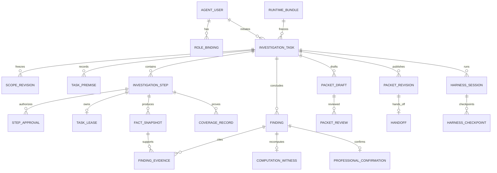
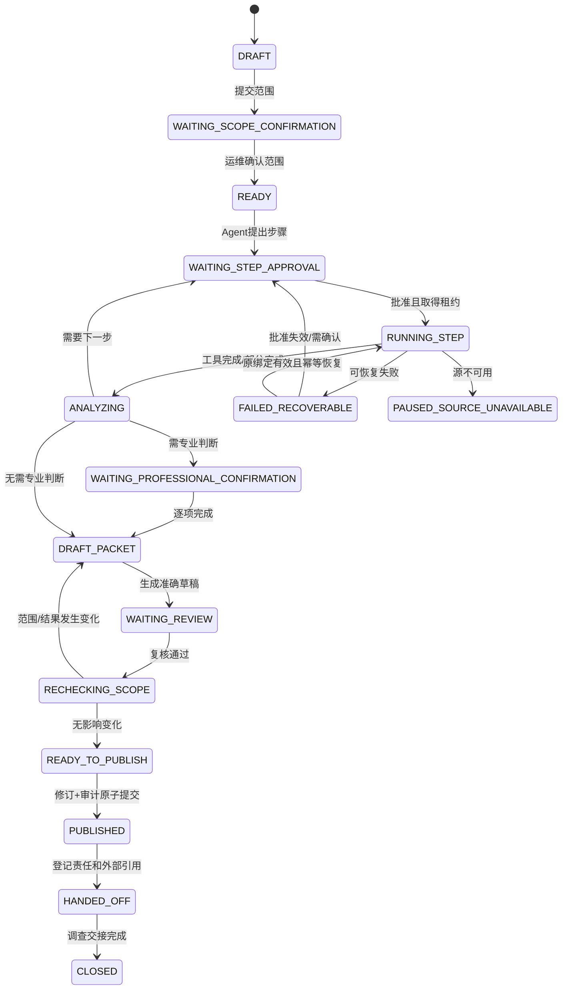

# 附件 A：领域模型、数据库与状态机

> 所属主方案：[财务共享智能运维 Agent 生产落地技术方案](00-财务共享智能运维Agent-生产落地技术方案.md)
> 定位：给出应用自有领域模型、接近可执行的 PostgreSQL DDL、业务状态机和关键事务伪代码。源系统表名和字段只允许通过 P0 映射目录补充，不在本附件猜测。

## 1. 领域边界

| 子域 | 核心对象 | 权威内容 |
|---|---|---|
| 身份与权限 | `AgentUser`、`RoleBinding` | Agent 内角色和统一身份映射 |
| 调查任务 | `Task`、`ScopeRevision`、`Premise`、`Step`、`StepApproval`、`Lease` | 任务边界、状态、批准和执行顺序 |
| 证据与计算 | `FactSnapshot`、`CoverageRecord`、`Finding`、`ComputationWitness`、`ProfessionalConfirmation` | 最小事实、覆盖、可复算判断和人审 |
| 决策包 | `PacketDraft`、`PacketRevision`、`Review`、`Handoff` | 草稿、准确复核、不可变发布和外部交接 |
| Harness | `HarnessSession`、`Checkpoint`、`WorkspaceRef`、`PlanRevision` | Agent 执行状态，不是业务权威 |
| 知识 | `KnowledgeDocument`、`Chunk`、`EmbeddingSet` | 经审批的背景资料和检索索引 |
| 治理审计 | `RuntimeBundle`、`AuditEvent`、`OutboxEvent`、`P0Fact` | 版本组合、审计、外发和待确认事实 |

## 2. 聚合与不变量

### 2.1 `Task` 聚合

- `task_id` 全局唯一；`initiator_user_id` 必须映射唯一人员编号。
- 任一时刻最多一个 `current_step_id` 和一个未过期活动租约。
- 任务冻结一个 `runtime_bundle_id`；运行中不能静默切换模型、规则、提示、工具或源映射。
- `ScopeRevision` 不可修改。范围变化创建新版本，并使旧步骤审批和未复核草稿失效。
- 等待人工确认的任务无租约，不消耗 Worker。

### 2.2 `StepApproval` 聚合

批准绑定：`goal_hash`、`source_binding_id`、`scope_revision_id`、`field_policy_version`、`query_template_version`、`max_calls`、`expires_at`。只有所有绑定相同且 `used_calls < max_calls` 才允许重试。

### 2.3 `PacketRevision` 聚合

- `PacketDraft` 可反复生成，每次有独立内容摘要。
- `Review` 必须绑定准确 `draft_id + content_digest + scope_revision_id + runtime_bundle_id`。
- 发布前复核无变化后，`PacketRevision` 与 `AuditEvent` 同事务写入。
- 已发布修订无更新语句；更正创建新修订并引用 `supersedes_revision_id`。

## 3. ER 图



## 4. PostgreSQL schema 和角色

### 4.1 角色原则

```sql
-- 名称为基线建议；实际命名由 P0 环境规范确认。
CREATE ROLE fa_owner NOLOGIN;
CREATE ROLE fa_migration LOGIN;
CREATE ROLE fa_app LOGIN;
CREATE ROLE fa_publisher LOGIN;
CREATE ROLE fa_knowledge_ingest LOGIN;
CREATE ROLE fa_viewer LOGIN;
CREATE ROLE fa_audit_reader LOGIN;

CREATE SCHEMA iam AUTHORIZATION fa_owner;
CREATE SCHEMA task AUTHORIZATION fa_owner;
CREATE SCHEMA evidence AUTHORIZATION fa_owner;
CREATE SCHEMA packet AUTHORIZATION fa_owner;
CREATE SCHEMA harness AUTHORIZATION fa_owner;
CREATE SCHEMA knowledge AUTHORIZATION fa_owner;
CREATE SCHEMA governance AUTHORIZATION fa_owner;
```

应用账号无 `CREATE` 权限。DDL 只由 Flyway 的 `fa_migration` 执行；发布服务使用受限 `fa_publisher` 数据源。生产授权语句须由安全评审结合实际平台生成。

### 4.2 扩展和通用约定

```sql
-- 仅在平台确认服务端扩展版本后由迁移角色执行。
CREATE EXTENSION IF NOT EXISTS vector;

-- 主键采用 UUID；时间统一 timestamptz；JSONB 只承载有 schema/version 的扩展属性。
-- 每张领域表统一包含 created_by、created_at、updated_by、updated_at；人员字段为可空 UUID 外键，系统生成记录可不绑定人员。
-- digest 使用小写 hex SHA-256；用户身份保存统一认证 subject 和唯一人员编号。
```

## 5. 核心 DDL 草案

### 5.1 身份、版本和任务

```sql
CREATE TABLE iam.agent_user (
  user_id uuid PRIMARY KEY,
  auth_subject varchar(200) NOT NULL UNIQUE,
  employee_no varchar(100) NOT NULL UNIQUE,
  display_name varchar(200) NOT NULL,
  status varchar(20) NOT NULL CHECK (status IN ('ACTIVE','DISABLED')),
  created_at timestamptz NOT NULL DEFAULT now(),
  updated_at timestamptz NOT NULL DEFAULT now()
);

CREATE TABLE iam.role_binding (
  user_id uuid NOT NULL REFERENCES iam.agent_user(user_id),
  role_code varchar(30) NOT NULL CHECK (role_code IN ('OPERATOR','VIEWER','PLATFORM_ADMIN')),
  granted_by uuid REFERENCES iam.agent_user(user_id),
  granted_at timestamptz NOT NULL DEFAULT now(),
  revoked_at timestamptz,
  PRIMARY KEY (user_id, role_code, granted_at)
);

CREATE TABLE governance.runtime_bundle (
  runtime_bundle_id uuid PRIMARY KEY,
  application_version varchar(80) NOT NULL,
  agentscope_version varchar(40) NOT NULL,
  model_binding_version varchar(80) NOT NULL,
  prompt_bundle_version varchar(80) NOT NULL,
  rule_set_version varchar(80) NOT NULL,
  tool_catalog_version varchar(80) NOT NULL,
  source_catalog_version varchar(80) NOT NULL,
  knowledge_release_id uuid,
  bundle_digest char(64) NOT NULL UNIQUE,
  status varchar(20) NOT NULL CHECK (status IN ('DRAFT','TESTED','PUBLISHED','RETIRED')),
  created_at timestamptz NOT NULL DEFAULT now()
);

CREATE TABLE task.investigation_task (
  task_id uuid PRIMARY KEY,
  title varchar(300) NOT NULL,
  original_question text NOT NULL,
  initiator_user_id uuid NOT NULL REFERENCES iam.agent_user(user_id),
  status varchar(50) NOT NULL,
  runtime_bundle_id uuid NOT NULL REFERENCES governance.runtime_bundle(runtime_bundle_id),
  current_scope_revision_id uuid,
  current_step_id uuid,
  created_at timestamptz NOT NULL DEFAULT now(),
  updated_at timestamptz NOT NULL DEFAULT now(),
  row_version bigint NOT NULL DEFAULT 0,
  closed_at timestamptz,
  CHECK (status IN (
    'DRAFT','WAITING_SCOPE_CONFIRMATION','READY','WAITING_STEP_APPROVAL','RUNNING_STEP',
    'ANALYZING','WAITING_PROFESSIONAL_CONFIRMATION','DRAFT_PACKET','WAITING_REVIEW',
    'RECHECKING_SCOPE','READY_TO_PUBLISH','PUBLISHED','HANDED_OFF','CLOSED',
    'PAUSED_MODEL_UNAVAILABLE','PAUSED_BUDGET','PAUSED_SOURCE_UNAVAILABLE',
    'STALE_APPROVAL','FAILED_RECOVERABLE','CANCELLED'))
);

CREATE TABLE task.scope_revision (
  scope_revision_id uuid PRIMARY KEY,
  task_id uuid NOT NULL REFERENCES task.investigation_task(task_id),
  revision_no integer NOT NULL,
  system_code varchar(100) NOT NULL,
  object_selector jsonb NOT NULL,
  effective_time_range jsonb NOT NULL,
  included_paths jsonb NOT NULL,
  excluded_paths jsonb NOT NULL,
  allowed_read_fields jsonb NOT NULL,
  allowed_retain_fields jsonb NOT NULL,
  allowed_model_fields jsonb NOT NULL,
  confirmed_by uuid NOT NULL REFERENCES iam.agent_user(user_id),
  confirmed_at timestamptz NOT NULL,
  scope_digest char(64) NOT NULL,
  schema_version varchar(30) NOT NULL,
  UNIQUE(task_id, revision_no),
  CHECK (jsonb_typeof(object_selector) = 'object')
);

ALTER TABLE task.investigation_task
  ADD CONSTRAINT fk_task_scope
  FOREIGN KEY (current_scope_revision_id) REFERENCES task.scope_revision(scope_revision_id);

CREATE TABLE task.task_premise (
  premise_id uuid PRIMARY KEY,
  task_id uuid NOT NULL REFERENCES task.investigation_task(task_id),
  premise_type varchar(50) NOT NULL,
  subject_key varchar(200) NOT NULL,
  statement text NOT NULL,
  provided_by uuid NOT NULL REFERENCES iam.agent_user(user_id),
  source_description text NOT NULL,
  provided_at timestamptz NOT NULL,
  independently_verified boolean NOT NULL DEFAULT false
);
```

### 5.2 步骤、批准、租约和调用

```sql
CREATE TABLE task.investigation_step (
  step_id uuid PRIMARY KEY,
  task_id uuid NOT NULL REFERENCES task.investigation_task(task_id),
  sequence_no integer NOT NULL,
  goal text NOT NULL,
  recommended boolean NOT NULL,
  status varchar(30) NOT NULL CHECK (status IN (
    'PROPOSED','WAITING_APPROVAL','APPROVED','RUNNING','SUCCEEDED','PARTIAL',
    'FAILED','CANCELLED','STALE')),
  created_at timestamptz NOT NULL DEFAULT now(),
  completed_at timestamptz,
  UNIQUE(task_id, sequence_no)
);

ALTER TABLE task.investigation_task
  ADD CONSTRAINT fk_task_current_step
  FOREIGN KEY (current_step_id) REFERENCES task.investigation_step(step_id);

CREATE TABLE task.step_approval (
  approval_id uuid PRIMARY KEY,
  step_id uuid NOT NULL REFERENCES task.investigation_step(step_id),
  revision_no integer NOT NULL,
  approved_by uuid NOT NULL REFERENCES iam.agent_user(user_id),
  approved_at timestamptz NOT NULL,
  expires_at timestamptz,
  goal_hash char(64) NOT NULL,
  source_binding_id uuid NOT NULL,
  scope_revision_id uuid NOT NULL REFERENCES task.scope_revision(scope_revision_id),
  field_policy_version varchar(80) NOT NULL,
  query_template_version varchar(80) NOT NULL,
  max_calls integer NOT NULL CHECK (max_calls > 0),
  used_calls integer NOT NULL DEFAULT 0 CHECK (used_calls >= 0),
  approval_digest char(64) NOT NULL,
  status varchar(20) NOT NULL CHECK (status IN ('ACTIVE','CONSUMED','EXPIRED','REVOKED','STALE')),
  UNIQUE(step_id, revision_no)
);

CREATE TABLE task.task_lease (
  lease_id uuid PRIMARY KEY,
  task_id uuid NOT NULL REFERENCES task.investigation_task(task_id),
  step_id uuid NOT NULL REFERENCES task.investigation_step(step_id),
  owner_instance varchar(200) NOT NULL,
  acquired_at timestamptz NOT NULL,
  heartbeat_at timestamptz NOT NULL,
  expires_at timestamptz NOT NULL,
  released_at timestamptz
);

CREATE UNIQUE INDEX ux_one_active_lease_per_task
  ON task.task_lease(task_id) WHERE released_at IS NULL;

CREATE TABLE task.tool_invocation (
  invocation_id uuid PRIMARY KEY,
  task_id uuid NOT NULL REFERENCES task.investigation_task(task_id),
  step_id uuid NOT NULL REFERENCES task.investigation_step(step_id),
  approval_id uuid NOT NULL REFERENCES task.step_approval(approval_id),
  tool_code varchar(100) NOT NULL,
  idempotency_key varchar(300) NOT NULL UNIQUE,
  request_digest char(64) NOT NULL,
  response_digest char(64),
  status varchar(30) NOT NULL CHECK (status IN ('INTENT_RECORDED','RUNNING','SUCCEEDED','PARTIAL','FAILED','UNKNOWN')),
  started_at timestamptz NOT NULL,
  completed_at timestamptz,
  error_code varchar(100)
);
```

### 5.3 证据、覆盖、发现和人工确认

```sql
CREATE TABLE evidence.fact_snapshot (
  snapshot_id uuid PRIMARY KEY,
  task_id uuid NOT NULL REFERENCES task.investigation_task(task_id),
  step_id uuid NOT NULL REFERENCES task.investigation_step(step_id),
  source_binding_id uuid NOT NULL,
  source_object_type varchar(100) NOT NULL,
  source_object_key varchar(300) NOT NULL,
  allowed_fields jsonb NOT NULL,
  checked_at timestamptz NOT NULL,
  effective_from timestamptz,
  effective_to timestamptz,
  effective_class varchar(30) NOT NULL CHECK (effective_class IN ('CURRENT_EFFECTIVE','FUTURE_SCHEDULED','UNDETERMINED')),
  source_version varchar(300),
  result_digest char(64) NOT NULL,
  field_policy_version varchar(80) NOT NULL,
  schema_version varchar(30) NOT NULL,
  created_at timestamptz NOT NULL DEFAULT now()
);

CREATE TABLE evidence.coverage_record (
  coverage_id uuid PRIMARY KEY,
  task_id uuid NOT NULL REFERENCES task.investigation_task(task_id),
  step_id uuid NOT NULL REFERENCES task.investigation_step(step_id),
  scope_revision_id uuid NOT NULL REFERENCES task.scope_revision(scope_revision_id),
  query_template_version varchar(80) NOT NULL,
  query_condition_digest char(64) NOT NULL,
  enumeration_method varchar(100) NOT NULL,
  page_count integer,
  expected_total bigint,
  observed_total bigint,
  traversed_paths jsonb NOT NULL,
  uncovered_paths jsonb NOT NULL,
  failures jsonb NOT NULL,
  source_watermark varchar(300),
  result_set_digest char(64) NOT NULL,
  completeness varchar(20) NOT NULL CHECK (completeness IN ('COMPLETE','PARTIAL','UNKNOWN')),
  checked_at timestamptz NOT NULL
);

CREATE TABLE evidence.finding (
  finding_id uuid PRIMARY KEY,
  task_id uuid NOT NULL REFERENCES task.investigation_task(task_id),
  finding_type varchar(50) NOT NULL,
  statement text NOT NULL,
  judgment_mode varchar(30) NOT NULL CHECK (judgment_mode IN ('DETERMINISTIC','HUMAN_CONFIRMED','UNKNOWN')),
  effective_class varchar(30) NOT NULL CHECK (effective_class IN ('CURRENT_EFFECTIVE','FUTURE_SCHEDULED','UNDETERMINED')),
  scope_revision_id uuid NOT NULL REFERENCES task.scope_revision(scope_revision_id),
  status varchar(20) NOT NULL CHECK (status IN ('DRAFT','CONFIRMED','STALE','WITHDRAWN')),
  created_at timestamptz NOT NULL DEFAULT now()
);

CREATE TABLE evidence.finding_evidence (
  finding_id uuid NOT NULL REFERENCES evidence.finding(finding_id),
  snapshot_id uuid NOT NULL REFERENCES evidence.fact_snapshot(snapshot_id),
  relation_type varchar(30) NOT NULL,
  PRIMARY KEY (finding_id, snapshot_id)
);

CREATE TABLE evidence.computation_witness (
  witness_id uuid PRIMARY KEY,
  finding_id uuid NOT NULL UNIQUE REFERENCES evidence.finding(finding_id),
  algorithm_version varchar(80) NOT NULL,
  rule_set_version varchar(80) NOT NULL,
  input_digest char(64) NOT NULL,
  output_digest char(64) NOT NULL,
  snapshot_ids jsonb NOT NULL,
  computed_at timestamptz NOT NULL,
  recompute_status varchar(20) NOT NULL CHECK (recompute_status IN ('NOT_RUN','MATCHED','MISMATCHED','UNAVAILABLE')),
  recomputed_at timestamptz
);

CREATE TABLE evidence.professional_confirmation (
  confirmation_id uuid PRIMARY KEY,
  finding_id uuid NOT NULL UNIQUE REFERENCES evidence.finding(finding_id),
  confirmed_by uuid NOT NULL REFERENCES iam.agent_user(user_id),
  confirmed_at timestamptz NOT NULL,
  scope_revision_id uuid NOT NULL REFERENCES task.scope_revision(scope_revision_id),
  decision varchar(20) NOT NULL CHECK (decision IN ('CONFIRM','REJECT','NEEDS_MORE_EVIDENCE')),
  rationale text NOT NULL,
  evidence_refs jsonb NOT NULL
);
```

### 5.4 决策包、审计和 outbox

```sql
CREATE TABLE packet.packet_draft (
  draft_id uuid PRIMARY KEY,
  task_id uuid NOT NULL REFERENCES task.investigation_task(task_id),
  draft_no integer NOT NULL,
  scope_revision_id uuid NOT NULL REFERENCES task.scope_revision(scope_revision_id),
  runtime_bundle_id uuid NOT NULL REFERENCES governance.runtime_bundle(runtime_bundle_id),
  canonical_content jsonb NOT NULL,
  content_digest char(64) NOT NULL,
  status varchar(20) NOT NULL CHECK (status IN ('CURRENT','STALE','WITHDRAWN','PUBLISHED')),
  created_at timestamptz NOT NULL DEFAULT now(),
  UNIQUE(task_id, draft_no)
);

CREATE TABLE packet.packet_review (
  review_id uuid PRIMARY KEY,
  draft_id uuid NOT NULL REFERENCES packet.packet_draft(draft_id),
  reviewer_user_id uuid NOT NULL REFERENCES iam.agent_user(user_id),
  content_digest char(64) NOT NULL,
  scope_revision_id uuid NOT NULL REFERENCES task.scope_revision(scope_revision_id),
  runtime_bundle_id uuid NOT NULL REFERENCES governance.runtime_bundle(runtime_bundle_id),
  decision varchar(20) NOT NULL CHECK (decision IN ('APPROVE','REJECT')),
  reviewed_at timestamptz NOT NULL,
  comment text
);

CREATE TABLE packet.packet_revision (
  packet_revision_id uuid PRIMARY KEY,
  task_id uuid NOT NULL REFERENCES task.investigation_task(task_id),
  revision_no integer NOT NULL,
  draft_id uuid NOT NULL UNIQUE REFERENCES packet.packet_draft(draft_id),
  canonical_content jsonb NOT NULL,
  html_snapshot text NOT NULL,
  content_digest char(64) NOT NULL,
  checked_at timestamptz NOT NULL,
  source_versions jsonb NOT NULL,
  coverage_summary jsonb NOT NULL,
  published_by uuid NOT NULL REFERENCES iam.agent_user(user_id),
  published_at timestamptz NOT NULL,
  supersedes_revision_id uuid REFERENCES packet.packet_revision(packet_revision_id),
  UNIQUE(task_id, revision_no)
);

CREATE TABLE packet.handoff (
  handoff_id uuid PRIMARY KEY,
  packet_revision_id uuid NOT NULL REFERENCES packet.packet_revision(packet_revision_id),
  owner_reference varchar(300) NOT NULL,
  external_process_reference varchar(500),
  downstream_status varchar(30) NOT NULL,
  handed_off_by uuid NOT NULL REFERENCES iam.agent_user(user_id),
  handed_off_at timestamptz NOT NULL
);

CREATE TABLE governance.audit_event (
  audit_event_id uuid PRIMARY KEY,
  task_id uuid,
  actor_user_id uuid,
  event_type varchar(100) NOT NULL,
  target_type varchar(100) NOT NULL,
  target_id varchar(200) NOT NULL,
  event_payload jsonb NOT NULL,
  payload_digest char(64) NOT NULL,
  occurred_at timestamptz NOT NULL,
  prev_event_digest char(64),
  event_digest char(64) NOT NULL UNIQUE
);

CREATE TABLE governance.outbox_event (
  outbox_id uuid PRIMARY KEY,
  aggregate_type varchar(100) NOT NULL,
  aggregate_id varchar(200) NOT NULL,
  event_type varchar(100) NOT NULL,
  payload jsonb NOT NULL,
  created_at timestamptz NOT NULL,
  delivered_at timestamptz,
  delivery_attempts integer NOT NULL DEFAULT 0
);
```

数据库通过授权策略禁止 `UPDATE/DELETE` 已发布修订和审计事件；应用层同时拒绝。是否使用触发器加固由 P0 数据库规范决定，但不能只依赖前端隐藏。

### 5.5 Harness 与知识

```sql
CREATE TABLE harness.session_state (
  session_id uuid PRIMARY KEY,
  task_id uuid NOT NULL REFERENCES task.investigation_task(task_id),
  user_id uuid NOT NULL REFERENCES iam.agent_user(user_id),
  harness_version varchar(80) NOT NULL,
  state_ref jsonb NOT NULL,
  state_digest char(64) NOT NULL,
  created_at timestamptz NOT NULL,
  updated_at timestamptz NOT NULL
);

CREATE TABLE harness.checkpoint (
  checkpoint_id uuid PRIMARY KEY,
  session_id uuid NOT NULL REFERENCES harness.session_state(session_id),
  task_id uuid NOT NULL REFERENCES task.investigation_task(task_id),
  step_id uuid REFERENCES task.investigation_step(step_id),
  approval_id uuid REFERENCES task.step_approval(approval_id),
  checkpoint_type varchar(50) NOT NULL,
  state_ref jsonb NOT NULL,
  state_digest char(64) NOT NULL,
  created_at timestamptz NOT NULL
);

CREATE TABLE knowledge.embedding_set (
  embedding_set_id uuid PRIMARY KEY,
  model_version varchar(100) NOT NULL,
  dimensions integer NOT NULL CHECK (dimensions > 0),
  status varchar(20) NOT NULL CHECK (status IN ('BUILDING','VALIDATING','ACTIVE','RETIRED')),
  created_at timestamptz NOT NULL
);

CREATE TABLE knowledge.document (
  document_id uuid PRIMARY KEY,
  title varchar(500) NOT NULL,
  source_ref varchar(1000) NOT NULL,
  document_version varchar(100) NOT NULL,
  applicable_scope jsonb NOT NULL,
  status varchar(20) NOT NULL CHECK (status IN ('UPLOADED','PARSED','REVIEWED','PUBLISHED','RETIRED')),
  approved_by uuid REFERENCES iam.agent_user(user_id),
  approved_at timestamptz,
  content_digest char(64) NOT NULL
);

-- vector 维度必须由激活的 embedding_set 确认后写入实际 Flyway 迁移，不能在本草案猜测。
CREATE TABLE knowledge.chunk (
  chunk_id uuid PRIMARY KEY,
  document_id uuid NOT NULL REFERENCES knowledge.document(document_id),
  embedding_set_id uuid NOT NULL REFERENCES knowledge.embedding_set(embedding_set_id),
  chunk_no integer NOT NULL,
  section_path text,
  page_no integer,
  content text NOT NULL,
  content_digest char(64) NOT NULL,
  embedding vector, -- 实施迁移应替换为 vector(<P0_CONFIRMED_DIMENSION>)
  metadata jsonb NOT NULL,
  UNIQUE(document_id, embedding_set_id, chunk_no)
);
```

## 6. 权威状态机



任意非终态可按授权转 `CANCELLED`。模型不可用和预算耗尽只暂停依赖模型的步骤；恢复时回到中断前允许状态，不跳过审批。

## 7. 关键伪代码

### 7.1 步骤审批校验

```java
ExecutionPermit validate(ExecutionRequest r) {
  Task task = taskRepo.lock(r.taskId());
  Step step = stepRepo.requireCurrent(task, r.stepId());
  Approval a = approvalRepo.requireActive(r.approvalId());
  require(task.status() == RUNNING_STEP || task.status() == WAITING_STEP_APPROVAL);
  require(a.stepId().equals(step.id()));
  require(a.scopeRevisionId().equals(task.currentScopeRevisionId()));
  require(a.goalHash().equals(hash(r.goal())));
  require(a.sourceBindingId().equals(r.sourceBindingId()));
  require(a.fieldPolicyVersion().equals(r.fieldPolicyVersion()));
  require(a.queryTemplateVersion().equals(r.queryTemplateVersion()));
  require(!a.isExpired(clock.now()) && a.usedCalls() < a.maxCalls());
  require(fieldPolicy.permits(r.requestedFields(), a));
  return permitSigner.sign(a, r.idempotencyKey(), shortTtl());
}
```

### 7.2 发布前范围复核

```java
RecheckResult recheck(Task task, PacketDraft draft) {
  Scope scope = scopeRepo.load(task.currentScopeRevisionId());
  require(draft.scopeRevisionId().equals(scope.id()));
  SnapshotSet latest = sourceGateway.enumerateEntireApprovedScope(scope, clock.now());
  CoverageRecord coverage = coverageVerifier.verify(latest);
  Delta delta = comparer.compare(draft.evidenceSet(), latest,
      ADDITIONS, REMOVALS, FIELD_CHANGES, EFFECTIVE_CLASS_CHANGES);
  if (delta.affectsDraft() || !draft.runtimeBundleId().equals(task.runtimeBundleId())) {
    return STALE_REQUIRES_NEW_DRAFT;
  }
  return new RecheckResult(coverage, latest.sourceVersions(), latest.checkedAt());
}
```

### 7.3 确定性计算见证

```java
ComputationWitness compute(Rule rule, List<FactSnapshot> snapshots) {
  require(snapshots.stream().allMatch(fieldPolicy::retentionAllowed));
  CanonicalInput input = canonicalizer.from(snapshots);
  RuleOutput output = ruleEngine.execute(rule.version(), input);
  return witnessRepo.append(rule.algorithmVersion(), rule.ruleSetVersion(),
      sha256(input), sha256(output), ids(snapshots), clock.now());
}
```

### 7.4 原子发布

```java
@Transactional("publisherTransactionManager")
PacketRevision publish(PublishCommand c) {
  Task task = taskRepo.lock(c.taskId());
  Draft draft = draftRepo.requireExactDigest(c.draftId(), c.reviewedDigest());
  Review review = reviewRepo.requireApproved(draft.id(), draft.contentDigest());
  RecheckResult recheck = recheckRepo.requireFresh(task.id(), draft.id());
  require(task.status() == READY_TO_PUBLISH);
  PacketRevision revision = revisionRepo.insertImmutable(draft, recheck, c.actor());
  auditRepo.append(PACKET_PUBLISHED, revision.id(), c.actor(), revision.digest());
  outboxRepo.append(PACKET_PUBLISHED, revision.id(), minimalEvent(revision));
  taskRepo.transition(task.id(), READY_TO_PUBLISH, PUBLISHED);
  return revision;
}
```

### 7.5 重启恢复

```java
ResumeDecision resume(Checkpoint cp) {
  Task task = taskRepo.lock(cp.taskId());
  if (!cp.stepId().equals(task.currentStepId())) return NEEDS_NEW_APPROVAL;
  Approval a = approvalRepo.find(cp.approvalId());
  if (!approvalGuard.stillValid(a, task)) return NEEDS_NEW_APPROVAL;
  Invocation last = invocationRepo.lastForStep(cp.stepId());
  if (last.status() == SUCCEEDED) return REPLAY_PERSISTED_RESULT;
  if (last.status() == UNKNOWN) return MANUAL_RECONCILIATION;
  return leaseService.acquireAndResume(task, cp);
}
```

## 8. Flyway 与数据演进规则

- 基线采用 `V1__create_schemas.sql`、`V2__iam_and_governance.sql`、`V3__task.sql`、`V4__evidence.sql`、`V5__packet_and_governance.sql`、`V6__harness.sql`、`V7__knowledge.sql`、`V8__audit_fields.sql` 顺序。
- 数据库创建与授权脚本独立放在 `scripts/database-bootstrap/V0_create_database.sql`，不得被 Flyway 业务迁移加载。
- 迁移只向前追加；已发布内容字段变化采用新列/新 schema version 和读取兼容期。
- JSONB 均绑定应用层 JSON Schema 版本，并建立必要的 check/index；不得把核心关系整体塞入 JSONB。
- 索引在 P1 查询计划和规模量测后确定；`task.status`、活动租约、`snapshot(task_id, source_object_key)` 和 `packet(task_id, revision_no)` 为首批候选。
- HNSW 不在空知识库阶段默认创建；达到量测阈值后通过独立迁移添加。

## 9. DDL 落地前必须确认

| 编号 | 事实 | 未确认时阻断 |
|---|---|---|
| `TBC-DB-01` | PostgreSQL 服务端和 pgvector 扩展版本 | 生产 Flyway 基线与兼容性签署 |
| `TBC-DB-02` | 平台角色/授权和 schema 命名规范 | 生产账号创建 |
| `TBC-DB-03` | Embedding 维度 | `knowledge.chunk.embedding` 最终迁移 |
| `TBC-DB-04` | 对象存储可用性及引用协议 | 大原件留存和导出归档 |
| `TBC-DB-05` | 保留期与清理策略 | 自动清理任务启用 |
| `TBC-DB-06` | 预计任务量、快照量和并发 | 最终索引、连接池、分区和容量结论 |

