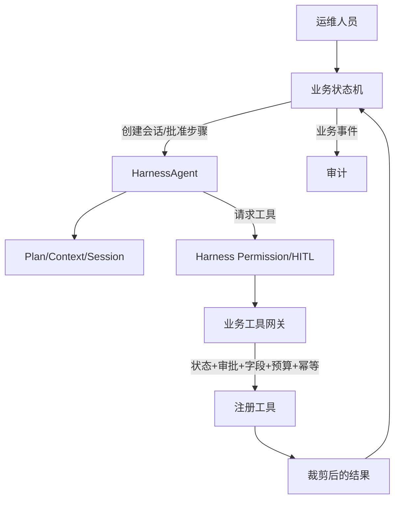

# 附件 C：Harness 能力映射与验证

> 所属主方案：[财务共享智能运维 Agent 生产落地技术方案](00-财务共享智能运维Agent-生产落地技术方案.md)
> 目标：在首期启用并验证 AgentScope Java 2.0.3 的完整 Harness 能力，同时用业务状态机、工具网关和数据策略把生产权限限制在批准边界内。

## 1. 版本前提

| 项目 | 基线 | 验证方式 |
|---|---|---|
| AgentScope Java | 2.0.3 BOM | 锁定 release/tag、依赖树和编译结果 |
| Java | JDK 17 | CI 与运行镜像均输出版本；官方 2.0.3 根 POM/CI 采用 Java 17 |
| Spring Boot | 4.0.4 | 由 2.0.3 BOM 对齐，不单独覆盖 |
| PostgreSQL JDBC | 42.7.11 | 由 BOM 对齐；测试目标服务端兼容性 |
| pgvector Java SDK | 0.1.6 | 由 BOM 对齐；服务端扩展版本另由 P0 确认 |

生产主实现使用 `HarnessAgent`。裸 `ReActAgent` 可用于框架学习或单元验证，但不作为最终生产任务运行时。

## 2. 双层控制模型



Harness 负责 Agent 执行机制；Java 业务状态机负责任务状态、范围、审批、证据、复核和发布。任何 Harness 恢复或 permission 结果都不能直接变更业务状态。工具执行必须同时通过 Harness 权限层和业务工具网关。

## 3. 能力映射

| Harness 能力 | 生产用途 | 数据落点 | 业务守卫 | 首期验证 |
|---|---|---|---|---|
| Session | 一个任务下的交互上下文 | `harness.session_state` | 绑定 task/user/runtime bundle | 新建、重连、越权读取 |
| State persistence | 保存可恢复执行状态 | session/checkpoint | 不保存禁止字段或完整原始响应 | 崩溃恢复、摘要一致性 |
| Workspace | 存放任务临时制品和引用 | 工作区引用/受控临时盘 | 路径隔离、配额、清理、禁止凭证 | 跨任务隔离、路径穿越 |
| Plan | 展示调查计划和下一步 | plan revision | 计划不等于审批；一次仅当前步骤 | 修改计划、范围扩张 |
| Context compression | 控制上下文长度 | 摘要+证据 ID | 摘要不能成为证据；可追到原快照 | 压缩前后事实引用一致 |
| Permission/HITL | 对高风险动作暂停 | approval reference | 审批卡冻结六项绑定 | 过期、篡改、重放 |
| Interruption/resume | 模型/源/进程中断后续跑 | checkpoint | 重验状态、审批、租约、幂等 | 各中断点故障注入 |
| Sandbox | 非敏感辅助计算 | 临时结果摘要 | 无生产网、无源凭证、无发布能力 | 网络/文件/凭证逃逸 |
| Skills | 复用已批准流程知识 | skill catalog/version | 管理员审核发布，任务冻结版本 | 未发布技能、版本漂移 |
| Subagents | 专用分析分工 | registered agent catalog | 不增权、不扩范围、不发布 | 权限继承和结果回收 |
| Long-term memory | 非敏感经验摘要 | approved memory entries | 不自动写配置、人员事实、结论 | 注入、跨任务泄露、删除 |

## 4. 会话、计划和上下文

### 4.1 会话绑定

会话创建时固定：`task_id`、`user_id`、`runtime_bundle_id`、`scope_revision_id`。用户继续对话可以补充任务前提、提出新方向或评价建议，但范围改变必须创建新 `ScopeRevision` 并重新批准，不能通过自然语言暗中扩张。

### 4.2 Plan 约束

- Plan 可以包含总体目标、已完成步骤、当前推荐步骤和候选后续步骤。
- UI 只把当前逻辑步骤转成审批卡；最多显示一个推荐动作和两个备选动作。
- 未审批的未来步骤不能预取数据或保留能力令牌。
- Plan 内容变化有修订号和摘要，但不要求每次文字改写都做人审；只有执行边界变化才需审批。

### 4.3 上下文压缩

压缩输出采用结构化摘要：

```json
{
  "taskId": "uuid",
  "scopeRevisionId": "uuid",
  "confirmedPremiseIds": ["uuid"],
  "evidenceRefs": [{"snapshotId": "uuid", "digest": "sha256"}],
  "findingRefs": [{"findingId": "uuid", "status": "CONFIRMED"}],
  "unknowns": ["string"],
  "currentStepId": "uuid",
  "summaryDigest": "sha256"
}
```

压缩器只保存引用和必要摘要，不复制完整快照。恢复时所有引用必须存在且摘要匹配；否则任务转人工检查。

## 5. Permission/HITL 与步骤能力

### 5.1 审批卡

审批卡必须展示：

- 调查目标；
- 数据来源；
- 本次范围；
- 请求字段及其读/留存/送模权限；
- 查询模板版本；
- 调用上限、审批有效期和是否允许同参数重试。

批准后由服务端签发短期内部 `ExecutionPermit`，绑定 `approval_digest` 和幂等键。能力令牌只在进程内传递，不发送给浏览器或模型。

### 5.2 二次守卫

```java
ToolResult invoke(HarnessToolCall call) {
  harnessPermission.requireAllowed(call);
  ExecutionPermit permit = businessGuard.validate(call);
  try (EphemeralSecret secret = secretProvider.forBinding(permit.sourceBinding())) {
    RawResult raw = registeredTool.invoke(call.typedArgs(), secret);
    TrimmedResult trimmed = fieldBoundary.validateAndTrim(raw, permit.fieldPolicy());
    return evidenceWriter.persistMinimal(trimmed, permit);
  }
}
```

模型生成的工具名和参数只能作为候选，实际调用对象从服务端注册表解析。无法解析、字段越权或预算超限均拒绝。

## 6. 中断与恢复语义

### 6.1 安全检查点

检查点只在以下位置创建：步骤审批完成后、工具调用意图入库后、已裁剪结果持久化后、确定性计算完成后、草稿生成后、发布前复核后。模型 token 流中间状态不作为业务检查点。

### 6.2 恢复决策

| 中断点 | 恢复动作 |
|---|---|
| 审批后、调用前 | 审批绑定仍有效则继续；否则重新批准 |
| 只读调用进行中 | 查调用状态；明确失败可在次数内重试，状态不明转人工对账 |
| 结果裁剪前 | 丢弃内存原响应，从调用状态恢复；禁止写 checkpoint |
| 最小快照已提交 | 重放持久化结果，不重复查询 |
| 模型生成中 | 丢弃不完整响应，预算内重新生成或转人工 |
| 发布事务中断 | 以幂等键查询；事务已提交则返回原修订，未提交则重新执行完整守卫 |

实例重启后，租约扫描器只接管已过期租约。当前租约未过期时不得并行恢复，防止双执行。

## 7. Workspace 与 Sandbox

### 7.1 Workspace

- 目录以 `task_id/session_id` 隔离，使用系统生成路径，不接受模型提供绝对路径。
- 只允许中间结构化文件、合成数据和待解析的获准知识材料。
- 决策包权威内容、证据和审计保存在 PostgreSQL/批准对象存储，不以 workspace 为唯一副本。
- 临时内容按可配置策略清理；任务保留策略未确认前不开启自动删除权威记录。

### 7.2 生产 Sandbox

允许：对合成/非敏感输入做格式转换、排序、哈希、辅助计算或文档解析。

禁止：

- 读取源系统、数据库或模型凭证；
- 访问生产财务系统网络；
- 直接连接 Agent PostgreSQL；
- 调用发布、角色管理或技能发布 API；
- 处理真实配置快照，除非后续单独评审并更新边界。

测试环境可验证完整 Sandbox 能力，但使用合成数据和隔离网络。

## 8. Skills

技能包必须包含名称、版本、适用任务类型、输入输出 schema、允许工具、字段类别、测试证据、审批人和内容摘要。状态为 `DRAFT → TESTED → PUBLISHED → RETIRED`。生产只加载任务 `runtime_bundle` 中的 `PUBLISHED` 版本。

Agent 可以在测试环境生成技能改进候选，但不能自动发布或进入生产。技能说明不能覆盖业务状态机、工具目录和字段策略。

## 9. Subagents

首期可注册少量专用子 Agent，以验证 Harness 完整能力，例如：

| 子 Agent | 允许输入 | 允许输出 | 禁止 |
|---|---|---|---|
| 证据整理 | 已裁剪快照引用 | 结构化候选关联 | 新查源、扩大范围 |
| 方案草拟 | 已确认发现、知识引用 | 建议草稿 | 宣称业务决定、发布 |
| 复核辅助 | 草稿、证据摘要 | 缺口列表 | 修改事实或批准自己 |

子 Agent 的有效权限是“主任务审批能力 ∩ 子 Agent 注册权限”，不能继承平台管理员能力。所有结果回到主业务状态机校验后才可使用。

## 10. 长期记忆

首期仅保存经人工批准的非敏感经验摘要，例如“某类调查通常需要核查哪些逻辑关系”。禁止自动写入：配置值、人员状态、人员编号、具体任务结论、凭证、源字段内容和业务决策。

记忆条目包含来源任务类别、抽象内容、敏感检查结果、审批人、版本、适用范围和撤回状态。检索到的记忆只作为规划提示，不能作为证据。

## 11. ModelGateway 与 Harness 的关系

Harness 只依赖 `ModelGateway`，不直接绑定供应商 SDK。首期只有一个模型实现，因此：

- 不做自动 fallback 或静默模型切换；
- 模型不可用时持久化暂停原因和位置；
- 结构化输出必须 JSON Schema 验证；
- 原始 prompt/response 不长期保留；
- 不向用户展示或保存内部推理链，只展示证据引用、简明理由和结构化结果。

## 12. 验证清单

### 12.1 功能验证

- [ ] `HarnessAgent` 在 JDK 17 和锁定 BOM 上编译、启动。
- [ ] session 可创建、重连，并拒绝跨用户/跨任务访问。
- [ ] plan 展示一个推荐和最多两个备选；未审批步骤不能执行。
- [ ] context compression 后的引用、摘要和未知项与压缩前一致。
- [ ] HITL 批准冻结六项绑定；修改任一绑定使批准失效。
- [ ] 中断/恢复覆盖所有安全检查点，不重复生成证据或修订。
- [ ] workspace 跨任务隔离，路径穿越和超配额失败。
- [ ] sandbox 无生产网络、凭证、数据库和发布能力。
- [ ] skills 只加载已发布版本，任务运行中版本不漂移。
- [ ] subagent 无增权、无发布、无范围扩张。
- [ ] 长期记忆只接受已审批非敏感摘要，撤回后不可检索。

### 12.2 安全负向验证

- [ ] prompt 注入要求绕过审批时，工具网关拒绝。
- [ ] 模型编造工具代码或源字段时，注册表/schema 拒绝。
- [ ] checkpoint 注入旧 approval ID 时，恢复转新审批。
- [ ] sandbox 尝试环境变量、网络、父目录和数据库访问均失败。
- [ ] 子 Agent 尝试调用主 Agent 未批准工具时失败。
- [ ] 未发布技能、已退役技能和摘要不符技能均无法加载。
- [ ] 长期记忆写入人员编号或配置值时被策略拒绝。
- [ ] 模型输出夹带额外 JSON 字段时 schema 失败。

### 12.3 故障注入验证

- [ ] 模型调用前/中/后进程终止。
- [ ] 源查询超时、分页中断、返回 schema 漂移。
- [ ] 裁剪前进程终止，确认原响应未落盘。
- [ ] 证据提交后进程终止，恢复不重复查询。
- [ ] 租约心跳丢失，第二 Worker 只在过期后接管。
- [ ] 发布审计写入失败，修订和任务状态整体回滚。
- [ ] 重启时 runtime bundle 或范围已变化，恢复转人工。

## 13. 能力放行记录

每项 Harness 能力都必须形成：版本、测试用例、环境、输入数据类别、结果、日志/截图/数据库证据、已知限制、签署人和日期。可以在同一生产版本中启用接口但限制业务用途；不能把“框架提供 API”视为“已验证可生产使用”。

## 14. 官方依据

- [AgentScope Java v2.0.3 Release](https://github.com/agentscope-ai/agentscope-java/releases/tag/v2.0.3)
- [AgentScope Java v2.0.3 根 POM](https://github.com/agentscope-ai/agentscope-java/blob/v2.0.3/pom.xml)
- [AgentScope Java v2.0.3 CI](https://github.com/agentscope-ai/agentscope-java/blob/v2.0.3/.github/workflows/maven-ci.yml)
- [AgentScope Java v2.0.3 BOM](https://github.com/agentscope-ai/agentscope-java/blob/v2.0.3/agentscope-dependencies-bom/pom.xml)

