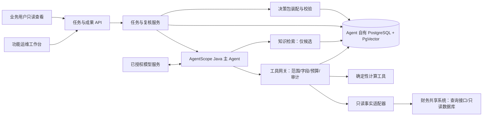

# 财务共享智能运维 Agent 详细方案

> 状态：第一性原理审查后的设计修订稿，供技术评审与实施准备；不是已上线能力说明。
> 依据：`共享智能运维Agent_初赛_v1.2.17.pptx` 的基础构想。需求澄清优先；既有方案仅作为机制参考。
> 目标：从首期 PoC 走向生产落地。具体接口、版本、容量和合规期限在实施盘点后锁定。

## 1. 方案摘要与边界

Agent 面向一套已有财务共享系统的**功能运维**。功能运维人员用自然语言提出问题，确认调查目标和范围；Agent 在受控范围内读取获准的配置事实，按证据选择下一步调查，调用确定性工具做可计算的判断，最后形成可保存、可复核、可交接的**调查决策包**。它还给出拟议处理方案和验证准备，但首期不修改财务系统。

| 维度 | 已确认的首期边界 |
|---|---|
| 使用者 | 功能运维人员发起、复核、发布；业务用户最多查看发布后的同一份决策包 |
| 任务 | 人工发起；目标、对象、范围经运维人员确认；不主动巡检或自行扩大范围 |
| 数据 | 只允许已授权的配置数据与必要的人员、组织、岗位、角色关联；真实发生的金额业务数据禁止读取 |
| 动作 | 只读调查、分析、拟议方案、验证准备；不写生产配置、流程或业务数据 |
| 结论 | 只确认配置事实及由配置推导的条件性风险，不判断实际发生的业务影响；可计算判断由确定性程序产生，不能计算的专业解释由功能运维人员确认，业务规则、职责安排与方案取舍等待业务确认 |
| 知识 | 文档和历史任务可提供线索，不能单独把新任务的结论升级为“已确认” |
| 存储 | Agent 自有 PostgreSQL；获准知识确有检索需求时再启用 PgVector；只留与结论有关的最小字段快照 |

首期 PoC 采用“审批人员 A 离职”作为**验证样例**，并非固定业务主线。生产验收须补充其他类型的功能运维问题，证明能力可复用。

调查结果按**当前生效**和**未来计划生效**分别呈现。前者只描述查询核查时点的配置状态；后者只描述已配置的未来生效安排及其条件，不合并成当前风险计数。不能读取真实业务记录，因此本方案不推断已有单据是否受阻、真实业务影响人数或金额。

## 2. 目标、非目标和职责

### 2.1 目标

1. 将一次功能运维调查从自然语言问题转为可追踪的任务：有发起人、对象、范围、数据边界和完成状态。
2. 让每条结论能够追溯到适用范围内的配置事实、核查时间、生效时间、来源版本和判断方法。
3. 在来源缺失、版本漂移、接口与数据库冲突时如实保留未知项，而非生成貌似完整的答案。
4. 用同一份决策包承载结论、证据、拟议方案、待业务确认事项和验证准备，并保留修订历史。
5. 为后续增加业务域、任务类型和更细的数据权限留下清晰的适配边界。

### 2.2 首期非目标

- 不自动修改配置、执行审批、回写流程或处理真实业务交易。
- 不读取真实发生的金额业务记录；不得以“仅供分析”为由绕过字段白名单。
- 不把大模型推断、RAG 相似命中或历史任务结论视为当前事实。
- 不要求业务用户在 Agent 内发起、补证、复核或作决定。
- 不承诺全系统覆盖；只对决策包明确列出的调查范围和可证明的覆盖部分负责。

### 2.3 人工职责

| 角色 | 首期职责 |
|---|---|
| 功能运维人员 | 发起任务、确认范围、处理扩大范围请求、复核专业判断、发布决策包、推动业务确认 |
| 业务用户 | 按授权查看发布后的决策包；首期不在 Agent 内操作 |
| 业务负责人 | 经现有流程决定职责安排、业务规则和方案取舍；结果由运维人员关联回原任务 |
| 系统/数据负责人 | 确认只读来源、字段白名单、权威来源、版本语义和接入凭证 |
| Agent | 组织调查、调用受控工具、汇总证据与未知项、起草建议和验证准备；不代替人工决定 |

## 3. 总体架构



架构划成五个责任面：

1. **交互与任务面**：工作台、任务 API、任务状态、人工复核和发布。
2. **调查编排面**：一个主 Agent 根据证据选择下一步，所有动作经工具网关。
3. **事实与计算面**：只读适配器取得配置事实；确定性程序计算引用、关系、版本差异和条件关系。
4. **成果面**：独立装配和校验决策包，拒绝无依据的确认结论与越界数据。
5. **自有数据面**：保存任务、会话状态、最小字段证据快照、成果修订、审计和获准知识索引；与财务系统数据库隔离。

AgentScope Java 用于主 Agent、工具注册、会话上下文及运行时扩展。框架只提供执行机制；**业务边界由本服务的任务控制器、工具网关和成果校验器落实**。框架已有 `ReActAgent`、`Toolkit`、`RuntimeContext` 与状态存储接口，实施时以锁定版本做兼容验证；不在本设计阶段假定某个版本或扩展自动满足生产要求。参见[官方 Agent 文档](https://github.com/agentscope-ai/agentscope-java/blob/main/docs/v2/en/docs/building-blocks/agent.md)与[工具文档](https://github.com/agentscope-ai/agentscope-java/blob/main/docs/v2/en/docs/building-blocks/tool.md)。

## 4. 任务与成果模型

### 4.1 核心对象

| 对象 | 必备字段 | 作用 |
|---|---|---|
| `Task` | `task_id`、发起人、问题原文、结构化目标、状态、创建时间 | 一次有界调查的主键 |
| `Scope` | 系统、组织/模块/流程集、对象标识、生效时间范围、允许读取字段/允许保留字段、排除范围、确认人 | 限定每次工具调用和成果声明 |
| `Premise` | 内容、提供人、提供时间、是否独立核实 | 保存“A 已离职”等任务前提，防止写成系统事实 |
| `FactSnapshot` | 来源、对象、获准字段和值、读取时间、来源版本或内容摘要、适用范围 | 最小字段证据快照 |
| `Evidence` | 证据 ID、快照引用、规则/文档引用、关联结论、覆盖范围 | 形成可回查的证据链 |
| `CoverageRecord` | 对象全集确定方式、查询模板/条件与结果摘要、范围版本或水位、分页/总量校验、已查路径、未覆盖路径、失败项、完成状态 | 证明哪些范围已查全，支撑“无匹配”的限定性陈述 |
| `Finding` | 结论类别、陈述、判断方式、证据引用、适用范围、未知原因 | 独立可复核的调查结果 |
| `Proposal` | 拟议方案、理由、前提、风险、待业务确认项 | 与事实和确认结论分开 |
| `VerificationItem` | 输入条件、预期、执行主体、状态 | 验证准备；未执行不能标为已验证 |
| `PacketRevision` | 修订号、内容摘要、复核人、发布时间、前版引用 | 同一任务的发布历史 |
| `ComputationWitness` | 证据快照 ID 集及输入摘要、算法与规则集版本/摘要、输出摘要、复验结果、计算时间 | 为可计算结论提供可独立复算的依据，不复制超出白名单的原始字段 |
| `HumanConfirmation` | 确认人、时间、理由、证据 ID、确认范围与对象 | 为不可计算的专业解释和配置风险判断留下人工责任记录 |
| `PublicationEvent` | 草稿修订、复核决定、幂等键、发布状态、本地审计记录 ID；必要时附外部审计回执 | 保证发布版与复核、审计一一对应 |
| `Handoff` | 调查完成时间、交接人/接收人、待业务确认事项、外部处理引用、跟踪状态 | 区分调查成果交接和业务问题解决 |

### 4.2 结论分类与判断权

| 类别 | 判定要求 | 示例 |
|---|---|---|
| 已确认配置事实 | 适用范围内的配置证据及来源版本支持；直接读取或确定性复验 | 查询时点的生效审批节点直接引用 A |
| 配置推导风险 | 规则条件、配置关系和任务前提共同支持；明确条件与生效时间，不声称实际业务后果 | 在“A 已离职”前提成立时，当前生效路径仍可能路由到 A |
| 已确认关联 | 关系存在，但是否构成配置风险还缺另一条件或业务决定 | A 与某岗位存在关联，岗位在目标流程中的生效情况待核 |
| 待核实候选 | 检索或关系追踪提示可能相关，尚缺关键事实 | 历史文档指向一个配置项，当前版本未取到 |
| 暂无法判断 | 来源缺失、冲突、版本不可对齐、超出授权或计算不支持 | 接口与只读库返回的生效版本无法解释地不同 |

每条结论还必须记录 `method=DETERMINISTIC | HUMAN_CONFIRMED | CANDIDATE`、`effective_class=CURRENT | FUTURE | UNDETERMINED`、适用范围和条件前提。生效时间无法判定时使用 `UNDETERMINED`，不得硬归入当前或未来。可由配置关系或条件规则计算的判断必须引用 `ComputationWitness`，不能改走人工确认捷径；确实无法计算的专业解释引用 `HumanConfirmation`，不得伪装成可复算结果。直接引用可用冻结快照上的独立查询复验；复杂规则根据实际风险选择第二实现或人工逐项核对，暂不预设双求解器。大模型可起草陈述与建议，不得写入“确定性计算完成”标记。运维复核是发布门槛；复核不等于把所有未知项改成确认，也不能把配置风险升级为实际业务影响。

“未发现匹配配置”是有条件的否定结论：只有 `CoverageRecord` 证明本次确认范围的对象枚举、分页、直接/间接关系和适用规则路径均已覆盖，且关键来源没有缺失或冲突时，才能写成“在该范围和核查时点未发现”。否则只写“已查部分未发现”，并列出未覆盖部分；不得写“无影响”或“全系统无引用”。

### 4.3 决策包最小结构

1. 任务目标、输入前提、发起人和调查时点。
2. 已覆盖范围、未覆盖范围、覆盖记录、使用的数据来源与版本；当前生效与未来计划生效分列。
3. 按类别列出的结论，每条附证据 ID、判断方式及复核状态。
4. 未知项与冲突，说明缺什么、下一步由谁补。
5. 拟议处理方案、理由、前提、风险，以及待业务确认事项。
6. 验证清单和状态，区分“待执行”“已执行”“未通过”。
7. 运维复核记录、发布修订号、交接状态、后续业务决定或处理结果的外部引用。

同一份决策包供有权人员查看；首期不做业务版与运维版两套内容。发布前是草稿，只有运维人员复核通过的修订版可供业务用户查看。后续补证或业务决定产生新修订，旧版只读保留直至到期清理。

决策包采用可校验的结构契约，至少包含 `packet_id`、`task_id`、`revision`、`status`、`scope`、`premises`、`source_versions`、`coverage`、`findings`、`unknowns`、`proposals`、`verification_items`、`review`、`handoff` 与 `published_at`。校验器须检查：所有确认结论指向获准范围内的证据及对应判断记录；否定结论有完整覆盖依据；当前与未来配置不混写；待业务确认项不得被写成已决定；未执行验证不得写成已通过；引用的版本与发布前核查结果匹配；发布修订不可覆盖。具体对象数、源字段数和 JSON Schema 在 P0 字段盘点后固化，不能从样例直接推定。

### 4.4 任务状态

调查任务状态为 `DRAFT → SCOPE_CONFIRMED → INVESTIGATING → READY_FOR_REVIEW → PUBLISHED → HANDED_OFF → INVESTIGATION_CLOSED`。旁路状态包括 `WAITING_FOR_INPUT`、`NEEDS_REFRESH`、`FAILED_RECOVERABLE`。`INVESTIGATION_CLOSED` 仅表示本轮调查成果已复核和交接，不表示业务问题已解决；后续业务处理与验证状态独立记录，并由运维人员关联现有流程的外部编号或结果。每次状态变更记录操作者、时间、原因与前后版本；发布修订不可原地覆盖。

任务可以暂停和续跑。需要运维人员确认扩大范围、补证或专业判断时进入等待态；源版本变化且未能重算时进入需刷新态。异常重试必须按 `task_id + step_id + tool_call_key` 幂等处理，避免重复生成证据或重复发布。

## 5. Agent 自身设计

### 5.1 能力与工具

首期工具按能力组织，工具名是设计契约，具体 Java 接口以实施验证为准：

| 能力 | 受控工具示例 | 输出 |
|---|---|---|
| 任务解析 | `normalize_task`、`propose_scope` | 结构化目标与范围建议，待运维确认 |
| 事实读取 | `get_config_object`、`find_references`、`list_versions`、`get_role_links`、`enumerate_scope` | 字段白名单内的配置事实、范围枚举及分页/水位元数据 |
| 确定性分析 | `resolve_effective_version`、`trace_approval_path`、`compare_versions`、`evaluate_conditions`、`classify_impact` | 可复算结果、输入摘要、规则版本 |
| 知识检索 | `search_approved_knowledge` | 带文档版本和适用范围的候选片段 |
| 成果处理 | `register_evidence`、`assemble_packet_draft`、`validate_packet` | 草稿与校验结果；发布由任务服务和人工复核控制 |

工具必须固定参数结构、对象类型、字段清单与最大返回量。LLM 不获得自由 SQL、任意 HTTP、文件执行、脚本执行或财务系统写工具。只读数据库查询由服务端预编译模板或受审查的参数化查询实现；在数据库层只授予获准视图/列的 `SELECT`，并设置连接只读、超时和行数上限。`@Tool(readOnly=true)` 只是框架声明，不能代替数据库权限、字段过滤和网关检查。

确定性工具以已冻结的最小字段快照为输入，登记算法工件标识、代码版本、规则集版本及摘要。计算结果与输入摘要绑定，并由与主计算路径分开的复验步骤核对关键关系；复验失败时降为待核实，不由模型解释为通过。对于不可计算的判断，界面要求运维人员逐项填写确认范围、理由和所依据的证据。只有运维复核通过且完成发布前版本核查，成果服务才可发布。

### 5.2 受约束调查循环

```text
输入问题 → 整理目标/对象/范围 → 运维确认
while 未结束:
    读取任务状态、已得证据、未知项和剩余预算
    找出最高优先级的证据缺口
    在允许的工具及参数内选择下一步
    执行前校验：身份/范围/字段/只读/调用量/来源状态
    执行工具，记录来源、版本、时间、输入和结果摘要
    更新覆盖记录：对象全集、分页、直接/间接路径、失败及未覆盖部分
    用确定性程序更新可计算判断；无法计算的留待人工
    检查重复调用、版本漂移、证据覆盖和停止条件
按当前/未来生效时间分别生成草稿 → 独立校验 → 运维复核 → 按范围复查 → 发布 → 交接
```

停止条件包括：已覆盖确认范围且结论有依据；需要人工专业或业务判断；授权来源无法取得；达到工具、时间或上下文预算；连续步骤不增加新证据；用户取消。停止不自动意味着查全：预算耗尽或来源缺失时可以形成带缺口的部分成果，但不得生成完整范围的否定结论。预算数值由 PoC 压测和成本约束确定，配置化管理，不在此凭空承诺。

### 5.3 记忆、上下文与会话

| 层次 | 保存内容 | 使用规则 |
|---|---|---|
| 当前推理上下文 | 当前目标、范围、证据索引、未决事项、最近工具结果 | 只放任务需要的最小片段；大结果保留引用，不整段灌入模型 |
| 会话状态 | 对话轮次、当前步骤、等待原因、可恢复指针 | 与 `task_id` 绑定，服务重启后可恢复；不作为结论真源 |
| 任务记忆 | 事实快照、证据、结论、审阅记录、成果修订 | 结构化持久化，供复核与续跑；发布结果以任务库为准 |
| 跨任务经验 | 历史问题类型、调查路径、常见缺口 | 仅用于候选线索；新任务必须重新取当前事实 |
| 知识库 | 经批准的制度、配置说明、运维手册 | 仅解释语义和发现线索，不直接产当前事实 |

上下文压缩保留任务目标、范围、已确认的证据 ID、未知项、下一步与预算，绝不把“候选”压缩成“确认”。源数据原文只存最小字段快照；模型输入再按任务裁剪。`RuntimeContext` 应始终携带真实的 `userId`、`sessionId`、`task_id`，避免匿名或默认会话混用；生产会话存储通过 AgentScope 的状态存储接口接到 Agent 自有存储，并在技术验证中测试并发、恢复与版本冲突。[官方状态存储说明](https://github.com/agentscope-ai/agentscope-java/blob/main/docs/v2/en/docs/building-blocks/agent.md)。

### 5.4 RAG

RAG 可为空启动。资料盘点后只索引批准的文档，入库时记录所有者、来源、版本、适用范围、有效期和敏感级别；失效文档下线或标记不可召回。检索先按权限、范围、版本过滤，再结合关键词与向量相似度给出候选，必要时重排。命中的内容始终显示出处，并回到当前配置事实核对。向量中不放真实金额业务数据，也不把任务快照默认向量化。

Agent 自有 PostgreSQL 存结构化任务数据，PgVector 扩展只负责向量列及检索。是否使用精确检索、HNSW 等索引由资料规模、过滤条件、召回率和延迟实测决定；PgVector 官方说明近似索引会在速度与召回之间取舍，过滤条件也会影响返回数量，不能把“装上索引”当成质量保证。[PgVector 官方文档](https://github.com/pgvector/pgvector/blob/master/README.md)。

### 5.5 运行时保障

- **预算与打转控制**：限制工具调用次数、每源读取量、单步耗时、任务总时长和模型上下文；同一缺口连续重复查询而没有新证据时停止并说明原因。
- **失败隔离**：接口、数据库、知识检索和模型分别设置超时、有限重试与熔断。单个来源失败不删除其他来源的有效证据，但依赖该来源的结论不得继续标“确认”。
- **断点恢复**：每个已完成步骤写入任务检查点；重启后从最后可靠步骤恢复，重新核对关键来源版本。
- **输出校验**：发布前检查任务范围、覆盖记录、证据引用、字段许可、结论判断权、当前/未来生效分类、未知项、版本有效性及人工复核记录；否定结论缺查全依据或配置风险被写成实际业务影响时，只返回待修复草稿。
- **可观测性**：记录任务成功率、等待与失败原因、工具拒绝次数、来源冲突、刷新次数、证据覆盖、模型和工具耗时、成本；日志中不写禁止读取的业务数据。
- **安全注入防护**：外部文档、配置说明及工具返回值均视为数据，不能改变系统指令、工具权限或任务范围。

## 6. 与财务共享系统的对接

### 6.1 对接边界和事实通道

首期面向**一套**财务共享系统。已知设想是复用现有查询接口和只读数据库账号；实际通道、字段和版本语义尚未盘点。优先调用系统已有的、能表达业务语义的只读查询接口；接口缺少关键配置时，经系统方确认增加最小只读接口，或使用受控只读视图。不能假定所有需要的事实都可通过数据库表结构直接理解。

| 通道 | 适用情形 | 必须返回或补充的元数据 | 控制点 |
|---|---|---|---|
| 现有查询接口 | 系统已定义对象和生效语义 | 来源对象 ID、适用范围、更新时间/版本、接口版本 | 参数白名单、身份鉴别、超时、分页、审计 |
| 只读数据库视图 | 接口未覆盖但表结构及语义已获系统方确认 | 主键、必要字段、更新时间/版本；若无版本则记录读取时间和行摘要 | 独立只读账号、列级投影、参数化 SQL、行数限制 |
| 最小新增只读接口 | 现有两类通道均不足以取得关键事实 | 与现有权威配置保持一致的对象、版本和时点说明 | 系统方设计与验收；不增加写入能力 |

不让大模型自行连接数据库，也不直接给大模型数据库账号。工作台把任务交给 Agent；Agent 仅能调用工具网关暴露的受控能力。事实目录分别登记**允许源端读取的字段**和**本任务允许保留/送入模型的字段**；真实发生的金额业务数据始终禁止读取。优先让查询接口或只读视图在源头只返回任务所需的 3 个字段。若接口只支持一次返回 50 个配置字段，且这 50 个字段均获准由受控适配器读取，则适配器可以在隔离进程的内存中临时接收，立即裁成任务所需的 3 个；另外 47 个字段不得进入缓存、证据快照、日志、异常栈、链路追踪、模型请求或向量索引。若返回内容含禁止读取的字段，或无法证明裁剪前不会被记录，该通道不得用于首期。

引用检索必须同时交代**候选对象全集如何确定**及**结果是否查全**。适配器为范围枚举、查询条件、总量/分页、直接引用、岗位/角色间接关系、代理或动态规则的可观察性分别返回完成状态；分页读取期间若源数据变动且没有一致性水位，需重新枚举或标记覆盖不完整。无法枚举或无法解释的规则路径记为覆盖缺口。仅返回匹配记录而不给出完整性元数据的接口，不能支撑“未发现引用”的完整范围结论。

### 6.2 来源权威、交叉印证与冲突

建立**事实目录**，逐项登记：业务对象、配置字段、系统所有者、权威通道、可替代通道、生效语义、版本字段、允许读取字段、典型冲突及人工联系人。权威来源按“对象/字段/适用条件”定义，不能全局规定“一律信 API”或“一律信数据库”。

两条通道读取同一事实时，先核对对象 ID、范围、生效版本和读取时点；再比较相关字段。差异若由缓存延迟、草稿/生效版本、转换规则等可解释，则记录解释与依据；若无法解释，输出来源冲突和待核实项，不由 Agent 猜测取舍。交叉印证可以增加信心，却不自动替代来源权威和人工确认。单一权威来源可用于确认明确事实，但要如实标注没有独立交叉来源。

### 6.3 最新时点与版本一致性

“最新”定义为**在本次调查许可范围内、各来源当前可取得的数据**，并非跨系统绝对同一时刻的全局快照。成果分别声明核查时点的当前生效配置与查询到的未来计划生效配置；任务首次读取、后续计算和发布前复核都记录 `observed_at`、`source_version`、`effective_from/to`（若有）、`source_id` 和范围查询版本或水位。

1. 调查开始时取得目标范围内的当前版本，并在证据中固定该版本；每条结论记录所用快照和最早、最晚读取时点，供审阅跨源读取跨度。
2. 计算和人工复核引用固定的证据版本，不静默改用后续版本。事实目录同时登记各来源版本/水位的可比性与更新延迟；若无法证明关键输入相容，该项降为待核实或暂无法判断，而非套用统一秒数阈值。
3. 发布前按**整个已确认范围**复查对象枚举、关系查询的版本/水位或结果摘要，并复查已取证的关键对象；这要能发现新增、删除或变更的引用，而不只检查已发现对象。即使配置版本未变，也要以发布前核查时间重新判定计划生效规则是否已转为当前生效。若源端无法提供范围级版本，则重跑受控范围查询并比较结果，记录复查完成时间与剩余一致性限制；变化时定位受影响的结论、重新取证与重算，并重新复验计算见证与受影响的人工确认。
4. 任务预算内不能完成刷新时，成果进入 `NEEDS_REFRESH`，不以旧版本作为当前结论发布。
5. 不同来源缺少可比较的时间或版本标记时，不声称严格一致；在决策包中写明可用的时点信息和限制。源系统与自有库没有跨库事务，复查后到发布之间仍可能出现变化，因此“当前”只表示截至记录的核查时点；历史发布版保留当时固定快照的复核能力，不因源系统后续更新而改写。

### 6.4 凭证、纳管与网络

- 查询接口使用独立服务身份和短期凭证（若平台支持）；数据库使用专门的只读账号，权限只到获准视图/列。密钥交给现有凭证管理设施，不写进提示词、配置文件仓库、任务库或日志。
- 首期两类人员均为现有 `admin` 级角色，因此不先实现复杂的用户级数据权限映射；**任务范围、只读和字段白名单始终强制执行**。后续细粒度权限作为生产扩展项，不能由“admin”推导出可读真实业务金额数据。
- 独立 Java 服务通过现有身份认证接入工作台，并按你们确认的方式纳管部署、网关、网络、监控和备份。具体 JDK、Spring、AgentScope Java、PostgreSQL/PgVector 版本在兼容性验证后锁定。
- Agent 服务到财务系统的网络只开放经批准的查询端点和只读库连接；禁止写入端点、任意外网工具及未经审查的 MCP/脚本能力进入首期工具集。

## 7. 数据、存储和安全设计

### 7.1 自有 PostgreSQL 逻辑分层

建议在 Agent 自有 PostgreSQL 内按职责分 schema 或等效权限域：

| 数据域 | 主要内容 | 访问原则 |
|---|---|---|
| `task` | 任务、范围、前提、状态、会话定位 | 任务服务可写；用户只通过 API 访问 |
| `evidence` | 最小字段快照、来源元数据、结论与证据关联 | 追加新版本；不得原地改写已发布证据 |
| `packet` | 决策包草稿、发布修订、人工复核和业务决定引用 | 草稿可修；发布版不可覆盖 |
| `knowledge` | 获准文档、片段、元数据与向量 | 独立导入流程；过期材料禁召回 |
| `audit` | 工具调用、权限拒绝、复核、发布、清理记录 | 追加记录并受限查询 |

PgVector 与关系表在同一数据库技术栈中，但不意味着所有数据都向量化。向量只服务于批准的知识检索；任务证据和结论以结构化关系存储。数据库账号按服务职责分开，并限制跨 schema 权限。部署前完成备份恢复演练、扩展安装测试和目标容量测算。

最小权限至少拆为：无登录权限的对象所有者、仅可追加获准快照的采集身份、仅可读取证据并写任务草稿的 Agent 身份、只可写发布修订的成果服务身份、只可追加审计的审计身份、只读查看发布版的查询身份。财务系统只读凭证与 Agent 自有库账号分离。具体 schema 与角色名可调整，但应用身份不得改写已发布证据或发布修订；数据库权限测试须覆盖 `UPDATE/DELETE` 已发布证据、跨域 `SELECT`、绕过采集身份写快照等拒绝用例。

### 7.2 最小字段证据快照

字段边界分两层：源端读取许可由系统方确认，任务留存许可由“任务所需字段 + 系统方允许保留字段”取交集。快照保存必要值、字段名、对象 ID、来源、读取时间、版本和摘要；可用摘要不能替代复核所需的原值时，保存允许的必要值。禁止“先全量持久化再删除不相关字段”的实现路径。对允许临时读取但不允许留存的返回字段，适配器必须在首次受控边界内丢弃，且禁止进入调试日志、异常栈、链路追踪和模型请求；禁止源端读取的字段不能依靠事后裁剪补救。

正式保留期限由你们后期自定义。方案只定义可配置的保留策略、到期清理、人工冻结和审计记录；不得在实施前凭空指定保存年数。清理时处理数据库行、向量索引、备份副本和导出文件，具体顺序与恢复窗口需按实际合规要求确认。

### 7.3 模型输入与输出控制

模型调用已获准使用限定配置数据，但每次输入仍按任务允许留存/送模字段裁剪。系统提示词只描述行为边界；真正的权限判断在工具网关、数据适配器和成果校验器。模型输出必须经过结构化解析和语义校验：对象 ID、版本、证据 ID 必须存在；“确认”级别不能高于判断程序或人工复核给出的级别；配置风险不得改写为已发生的业务影响，建议不可伪装为已执行变更。模型供应方、网关、数据出域范围及日志留存由你们部署时确认。

## 8. 工作台和接口契约

工作台首期提供四个页面能力：任务创建与范围确认、调查进度与证据查看、草稿复核与发布、已发布决策包查看。业务用户只看有权访问的发布版，同一份视图不分角色裁剪内容；访问控制仍按任务授权和发布状态检查。

建议的服务接口契约如下，字段为设计草案，实施时经系统方评审：

| 接口 | 关键输入 | 关键输出/约束 |
|---|---|---|
| `POST /tasks` | 问题原文、对象线索 | 任务 ID、结构化范围建议；不立即跨范围调查 |
| `POST /tasks/{id}/scope-confirmation` | 确认范围、排除范围、字段许可 | 固定本轮任务范围并启动调查 |
| `GET /tasks/{id}` | 任务 ID | 状态、已完成步骤、等待原因、预算消耗 |
| `POST /tasks/{id}/resume` | 补证/确认或重试理由 | 新调查步骤；幂等键防重复 |
| `GET /tasks/{id}/packet-draft` | 任务 ID | 草稿、证据链接和校验问题；仅运维人员可复核 |
| `POST /tasks/{id}/review` | 复核决定、备注、修订号 | 通过、退回或补证请求；记录复核人 |
| `POST /tasks/{id}/publish` | 已通过的草稿修订号、幂等键 | 按精确草稿修订和范围级复查结果核验；发布修订与本地审计记录原子提交 |
| `GET /tasks/{id}/packet/{revision}` | 修订号 | 同一份发布视图与可追溯证据 |
| `POST /tasks/{id}/handoff` | 发布修订号、交接人、接收人、待处理事项及外部流程引用 | 记录调查成果交接；不宣称业务问题已解决 |

所有写入只发生在**Agent 自有任务与成果库**，不写财务共享系统。API 实现需有身份认证、任务访问校验、请求幂等、审计及分页/大小限制。

发布须先确认同一草稿修订已由运维人员复核通过，且范围级复查没有发现未处理的版本或覆盖变化；复查引起结论或覆盖变化时，生成新草稿修订并重新交运维复核。若发布修订和审计记录均存 Agent 自有 PostgreSQL，二者在同一本地事务中原子写入；任一写入失败则均不发布。只有实际要求将审计投递到独立系统并以其回执作为可见条件时，才引入 outbox 和待审计状态。服务重试按 `task_id + draft_revision + idempotency_key` 返回同一结果，不能生成第二个发布版。若源在复查后立即变化，需用后续刷新任务形成新修订，不改写历史；交接与业务处理继续在独立状态中跟踪。审计设施及其可见条件在 P0/P1 确认。

## 9. “审批人员 A 离职”PoC 样例

样例输入：“审批人员 A 离职了，请在我确认的范围内检查相关审批配置。”其中“A 已离职”是**运维人员提供的前提**，记录提供人和时间；除非后来接入获准的人事状态来源，Agent 不把该前提改写为系统已核实事实。

1. 工作台把“A”消歧为财务系统内的人员/账号标识，记录离职前提的提供人和时间；建议组织、模块、流程集及当前/未来生效时间范围，由运维人员确认。若只覆盖部分流程，决策包必须写明未覆盖部分。
2. 适配器读取最小配置字段：有效流程版本、审批节点引用、人员/岗位/角色关联及生效状态；不读取审批金额或真实业务单据。
3. 确定性工具按确认范围枚举流程与配置对象，核对分页是否完整，再查直接引用、间接角色关联、代理/动态规则中可观察的路径，并把无法检查的路径写入覆盖记录；分别计算当前和未来计划生效的配置。每个结果保留配置位置、版本、计算规则与证据 ID。
4. 直接引用且处于当前生效路径的项记为“已确认配置事实”；在“A 已离职”的任务前提成立时，可进一步标为“配置推导风险”。未来计划生效的配置风险单列。只有间接关系的项先列“已确认关联”或“待核实”，不得机械扩大为实际业务影响。
5. 配置来源缺失、接口/库冲突、版本不明或范围未覆盖时列“暂无法判断”，并写明补证责任人。仅在范围枚举及相关路径均查全时，才能写“在该范围和核查时点未发现引用”。
6. 拟议方案可列出替换固定处理人、调整岗位/角色映射等选项；**接替人和职责安排**标为待业务确认。验证准备包括新配置的生效版本、路径覆盖、有效审批人和回退检查，状态均为待执行。
7. 发布前按确认范围复查对象清单、关系结果及关键配置版本；变更则重算。运维人员复核草稿后发布，业务用户可按授权查看同一决策包；随后由运维人员记录交接，不把调查结束写成问题解决。

此样例不预设“影响了多少条流程”。PoC 的正确性依赖实际已授权的配置样本和人工参考结论；初赛稿中的数字不能直接作为生产基线。

## 10. 分阶段落地和验收

| 阶段 | 交付范围 | 进入下一阶段的门槛 |
|---|---|---|
| P0：事实可得性与技术验证 | 先用最小确定性样例核实源系统能否按确认范围枚举配置、识别查全与查不全、区分当前/未来生效并复查范围变化；再验证 AgentScope Java、模型网关、PostgreSQL 和身份/只读连接。PgVector 随实际资料需求验证 | 证明必要配置语义、覆盖记录和范围级复查可实现；明确禁止读取与禁止保留字段的边界，越界内容不进入日志、模型或快照。若完全缺少支撑样例的核心事实，不进入业务 PoC；若只有部分路径不可观察，可带明确缺口开展部分覆盖 PoC |
| P1：闭环 PoC | 独立工作台最小版；“A 离职”任务；受约束调查循环、最小证据快照、确定性分析、覆盖缺口、当前/未来结果、草稿复核、发布与交接 | 与运维人工参考结论逐项比对；配置事实和风险表述不越界；否定结论有查全证明；来源缺失、范围新增引用和版本漂移处理符合规则 |
| P2：受控试点 | 增加不同功能运维样本、性能监控、备份恢复、操作手册和发布流程；有获准资料且检索有价值时再加入知识材料 | 多类别样本通过人工评审；能恢复中断任务；建立准确性、证据覆盖、耗时和成本基线；完成安全与运维评审 |
| P3：生产落地 | 锁定组件版本、容量、留存期限、HA/备份、告警、回滚、应急转人工及变更治理 | 正式验收用例、权限检查、恢复演练和运维交接全部通过；未决环境条件已由你们确认 |

阶段推进另设可核查的前置门槛；未满足时可以用合成样本继续做技术验证，但不得把该项标为真实业务能力已验收：

| 门槛 | 必须取得的输入与证据 | 未满足时停止的动作 |
|---|---|---|
| G1：源与字段 | 一套系统的对象/接口或视图清单、读取许可与留存许可、最小投影样例、范围枚举及分页完整性样例 | 未获读取许可时阻止真实源接入；无法证明查全时阻止完整范围的否定结论 |
| G2：版本与权威 | 对象/字段级权威来源、当前/未来生效语义、范围查询版本/水位或可重跑查询方式及冲突处置人 | 缺少生效或版本解释时阻止确认级配置结论；所有成果均须标注核查时点 |
| G3：模型与知识 | 模型获准输入范围；若启用 RAG，再确认 Embedding 输入范围、资料所有者与文档版本 | 未批准的真实配置不得送模型；未批准的资料不得索引，但不阻断无 RAG 的调查 |
| G4：存储与恢复 | 自有 PostgreSQL 角色授权、最小快照方案、备份恢复演练记录 | 发布版持久化和生产运行 |
| G5：参考样本 | 运维人员给出的任务范围、人工参考结论及反例，含不同问题类型 | 宣称业务准确性或可复用性达标 |
| G6：运行基线 | AgentScope Java 与运行环境兼容结论、并发/超时/成本测量及纳管方式 | 锁定生产容量、时限和部署方案 |

验收指标先定义**测量方法**，不伪造达标数值：

- **正确性**：逐条对照人工参考结论，区分漏报、误报及错误分类；样本应覆盖直接引用、间接关联、未来生效、条件冲突、缺源和版本变化。人工参考结论也须标明任务范围与核查时点，不能拿未知当“无风险”。
- **覆盖完整性**：对可查全的样本核对对象总量、分页和直接/间接路径；对不可查全的样本确认缺口明确展示，禁止完整范围的否定结论。
- **可追溯性**：每个确认项可定位对象、获准字段、来源、读取时间、版本、计算方法或人工确认记录。
- **可复核性**：可计算结论用冻结快照、算法与规则版本复算；不可计算结论有运维人员逐项确认记录。复算不一致时不通过验收。
- **数据边界**：对禁止读取的金额业务数据和未获准字段进行接口、SQL、日志、模型请求、快照和向量索引的端到端检查；违规计数必须为零。
- **只读性**：工具注册、服务账号权限、网络通道和系统审计均不出现财务系统写入能力或写入调用。
- **诚实降级**：来源缺失、冲突、超时、版本漂移时保留未知或需刷新，不把部分成功写成完整结论。
- **复核与恢复**：未复核草稿不可供业务用户查看；中断续跑不重复发布；旧修订可回查；调查交接与业务问题解决状态分离。
- **效率**：记录人工基线和 Agent 辅助耗时，再设目标；不得仅凭演示耗时宣称提效。

### 10.1 必测反例

| 用例 | 期望 |
|---|---|
| Agent 请求未注册的写工具或越界字段 | 执行前拒绝并审计；财务系统无写入或越界读取 |
| 只读接口返回 50 个获准读取的配置字段而任务只准留存 3 个 | 优先源头只返回 3 个；无法投影时受控适配器可在内存中立即裁剪，其余 47 个不得进入缓存、日志、模型、快照和索引 |
| 源接口包含任何禁止读取的字段 | 不依赖事后裁剪；拒用该通道并要求源头投影或受控新接口 |
| 当前接口与数据库对同一配置生效版本不一致 | 记录冲突及待核实，不能任意选边 |
| 原查询未发现引用，但分页缺页或动态路径不可观察 | 标为部分覆盖和未知，不输出完整范围的“无引用/无风险” |
| 发布前新增一个引用 A 的配置对象，原已发现对象均未变化 | 范围级复查发现新增对象并重新取证；做不到则标记需刷新 |
| 未来计划生效的规则引用 A | 单列未来配置风险，不混入当前生效结果 |
| 调查时规则尚未生效，但发布前已到生效时点且配置版本未变 | 重新判定为当前生效，重算相应风险并复核，不能仅凭版本未变发布旧分类 |
| RAG 找到旧制度但当前配置不支持 | 仅提示调查线索，不产已确认配置事实或风险 |
| A 的离职状态仅来自任务输入 | 标为输入前提，不标为已核实系统事实 |
| 运维人员未复核草稿 | 业务用户不可查看发布版 |
| 计算输入、规则或算法版本被替换，或复验结果不同 | 见证校验失败；不得保留确认级别或发布 |
| 人工确认缺少确认人、范围、理由或证据 | 成果校验拒绝发布；不得补造计算见证 |
| Agent 自有库的运行身份尝试改写已发布证据或修订 | 数据库拒绝并审计；查询身份不得看到草稿 |
| 本地发布修订写入成功而审计记录写入失败，或重复请求同一幂等键 | 本地事务整体回滚；重复请求不新增修订。若另接独立审计系统，按批准的回执门槛测试 |
| 决策包已发布并交接，但业务方案尚未执行 | 调查可标记完成；业务处理与验证保持未完成，不展示“问题已解决” |
| 任务中断后恢复 | 保持范围、证据关联与幂等状态，不重复生成发布修订 |

## 11. 待盘点、待确认与不做虚假承诺

| 编号 | 待解决事项 | 责任/处理时点 |
|---|---|
| U1 | 财务系统现有查询接口、只读库视图、对象关系、读取/留存字段许可、范围枚举和分页完整性 | 系统/数据负责人，P0 |
| U2 | 各类配置事实的权威来源、范围级版本/水位、当前与未来生效区间及源时区语义、跨源同步延迟 | 系统/数据负责人，P0 |
| U3 | 可供测试的最小配置样本及运维人工参考结论；禁止使用真实金额业务数据 | 运维负责人，P0/P1 |
| U4 | AgentScope Java、JDK、Spring、PostgreSQL 驱动的兼容版本；PgVector 在确需 RAG 时再验证 | 技术负责人，P0 后锁定核心组件 |
| U5 | 获准模型网关、Embedding 模型、知识材料清单及资料有效期 | 模型/知识负责人，P0/P2 |
| U6 | 并发任务数、配置规模、可接受时延、调用与存储成本目标 | 运维/技术负责人，P1 实测 |
| U7 | 保留期限、清理规则、备份窗口、RTO/RPO、审计留存与数据出域细则 | 你们后续自定义，P3 前确认 |
| U8 | 现有认证、网关、网络、监控、部署纳管和业务确认流程的实际接入方式 | 平台/业务负责人，P0/P3 |
| U9 | 从首期 `admin` 角色向细粒度权限扩展的时点与规则 | 安全/业务负责人，生产扩展前确认 |
| U10 | 成果结构契约的具体对象与字段、计算规则集版本策略和复验方式 | 系统/技术/运维负责人，P0/P1 |
| U11 | 审计是否仅存自有 PostgreSQL，或必须接独立审计设施并等待回执 | 平台/技术负责人，P0/P1 |
| U12 | 运维人员交接成果时的接收人、外部流程编号和后续状态回填方式 | 运维/业务负责人，P1/P2 |

以上未知项必须在文档和验收记录中保留真实状态。设计允许在 U1/U2/U3 尚未盘点完时开展框架和数据边界验证，但不能据此宣称业务结论、性能或生产可用性已经验证。

## 12. 设计依据

- [初赛稿](./共享智能运维Agent_初赛_v1.2.17.pptx)：仅提供产品背景与场景示意；本文的技术实现是本轮重新设计。
- 本轮需求澄清：角色、只读边界、最小字段、最新时点与版本、人工复核、验证样例、分阶段生产目标。
- [AgentScope Java 2.x 官方 Agent 文档](https://github.com/agentscope-ai/agentscope-java/blob/main/docs/v2/en/docs/building-blocks/agent.md)：主 Agent、运行上下文与状态存储接口。
- [AgentScope Java 2.x 官方工具文档](https://github.com/agentscope-ai/agentscope-java/blob/main/docs/v2/en/docs/building-blocks/tool.md)：工具注册、只读标记与外部工具能力。
- [PgVector 官方文档](https://github.com/pgvector/pgvector/blob/master/README.md)：向量类型、检索与索引的实现和限制。

## 13. 对既有方案的取舍

| 既有方案中的做法 | 本方案的处理 | 理由 |
|---|---|---|
| 计算见证、成果结构校验与数据库最小权限 | 吸收为可复算证据、最小成果契约和职责分离；具体字段及复验实现待盘点 | 增强复核与隔离，且不预设源系统结构 |
| 版本水位、跨源一致性与发布防重 | 吸收原则，按确认范围复查新增/删除/变更；同库发布与审计原子提交，独立审计设施确有要求时再等待回执 | 满足“截至核查时点”的可追溯性，同时避免无依据增加发布等待链路 |
| 分阶段门槛与故障反例 | 改写为 G1–G6 的输入、证据和阻断动作 | 让未决条件影响验收结论，而非被当成已具备能力 |
| 固定对象/字段数量、五类通道、两个 PoC 主线、固定时延阈值与指定组件版本 | 暂不采纳 | 源接口和材料尚未盘点，首期只确认一套系统、一个验证样例与受控只读通道 |
| 默认双求解器、MCP/Skill 编排、业务用户在 Agent 内作决定、固定人天估算 | 暂不采纳 | 超出当前可证实的需要或首期业务边界；待样本、风险和部署基线明确后再评估 |
